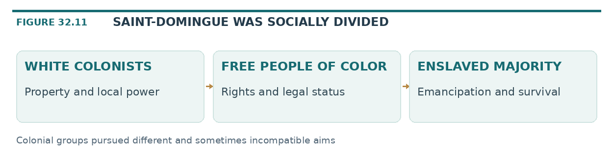

Колониалното плантационно общество прави правни различия между поробените лица, свободните хора на цвят и белите, докато богатството, статута, мястото на раждане и политическите съюзи усложняват тези категории. Френският колониален закон, включително традицията на Код Ноар, регламентирал аспектите на робството, но не го направил хуманен. Дисциплината на плантацията, принудителната работа, сексуалното насилие, високата смъртност и постоянното пристигане на поробените африканци бяха условия на експортната икономика, а не случайни злоупотреби от страна на шепа хора.

Дори и под принуда, поробените хора създали колективен живот. Семействата, религиозните събирания, езиковите практики, музиката, пазарните борси и неформалните мрежи позволиха оцеляването и понякога организираха съпротива. Маронеж бягал от робството, понякога в независимите общности бил една форма на съпротива; саботаж, преговори, полет и запазване на културната автономия вземали други. История, написана единствено чрез прокламации от Париж, пропуска институционалните знания и инициатива, необходими за бунта.

<figure class="figure" id="figure-32-11">

<figcaption>Фигура 32.11. Колониалните групи преследвали различни и понякога несъвместими цели. <a class="figure-anchor" href="#figure-32-11" aria-label="Link to this figure">#</a></figcaption>
</figure>

Френската революция зададе взривоопасен въпрос. Ако правата принадлежат на човешките същества, по какъв принцип една империя може да класифицира някои човешки същества като собственост? Представители на плантаторите се опитаха да защитят робството и търговските привилегии. Свободните цветнокожи искаха права, които белите обикновено им отказваха. Поробените хора биха могли да притиснат по-радикално търсене от която и да е страна, приета първоначално: унищожението на самото робство.
