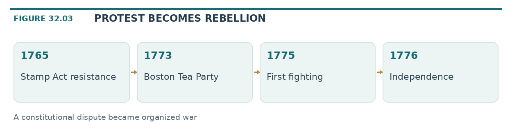

След 1763 г. Парламентът предприе нови имперски приходи и регулаторни мерки. Законът за печатите от 1765 г. налага задължения върху печатни материали, предизвиква протести, петиции и организирана съпротива. Колонистите спореха за данъчното облагане без представителство в парламента, докато британски представители подчертаха, че парламентът претендира за суверенитет над империята. Отмяната на една мярка не разреши основния конституционен спор. По-късно Таунсенд мита и Закона за чая от 1773 поднови аргумента за това кой може законно да облага кого.

Противниците на имперските мерки организираха бойкоти, комитети за кореспонденция, публични демонстрации и понякога сплашване. Бостънското чаено парти от декември 1773 г. драматизира съпротивата срещу Закона за чая и привилегиите на Източноиндийската компания. Наказателният отговор на Великобритания през 1774 г. затвори Бостънското пристанище и промени правителството Масачузетс, наред с други мерки; патриотичните лидери определиха тези закони като непоносими. Политическата комуникация, търговският натиск и местната мобилизация направиха конфликта все по - труден за овладяване.

<figure class="figure" id="figure-32-3">

<figcaption>Фигура 32.3. Конституционният спор стана организирана война. <a class="figure-anchor" href="#figure-32-3" aria-label="Link to this figure">#</a></figcaption>
</figure>

Аргументът не беше просто, че данъците са високи. Някои спорни данъци бяха относително малки в сравнение с конституционния принцип, заложен на карта. Нито търговците и потребителите винаги са били обединени: бойкотите налагат икономически жертви неравномерно. Обърнете внимание как конституционното значение и материалните интереси се укрепват взаимно. Колонистите тълкували мерките за приходите като заплаха за наследените политически права; британските власти тълкували организираното неподчинение като заплаха за способността на империята да управлява.
