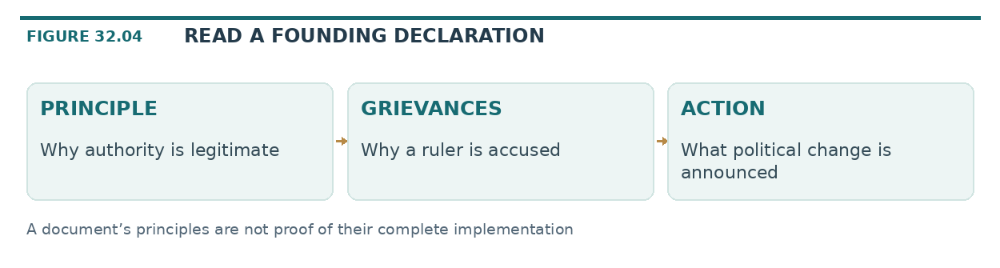

На 4 юли 1776 г. Континенталният конгрес прие Декларацията за независимост. Аргументът му съчетавал твърдението за правото на хората да се отделят от потискащото правителство със списък с оплаквания срещу Джордж III. Той представи законната власт като зависима от съгласието на управляваните и описани права, които не могат просто да бъдат предадени на владетелите. Тези идеи бяха влиятелни, но не започна със самия документ: по-стари конституционни, религиозни и просвещение аргументи са подготвили земята.

Прочетете най-известните му предложения внимателно. Когато тя провъзгласила човешкото равенство, създала ли е равен граждански статут за поробени хора, жени или местни народи? Не. Декларацията беше твърдение за независимост и политически принцип; тя не беше статут за незабавно премахване или универсален закон за гласуване. Много жестомимики се възползвали от робството или приели териториалното разширяване, което навредило на местните народи. Противоречието не прави езика исторически незначителен; то прави разликата между обещания и институции централна в разбирането на новата република.

<figure class="figure" id="figure-32-4">

<figcaption>Фигура 32.4. Принципите на документа не са доказателство за пълното им прилагане. <a class="figure-anchor" href="#figure-32-4" aria-label="Link to this figure">#</a></figcaption>
</figure>

Упражнение с първичен източник: да се разделят три слоя в Декларацията. Едната е политическа философия: защо правителството е легитимно. Второ е обвинението: обвинения за поведението на краля, някои от които избирателно са в рамка. Трета е политическото действие: колониите се провъзгласяват за държави. Доказателство, че е приета декларация, установява третия слой; оценката на втория изисква по-широк контекст; преценявайки как напълно първата е била приложена изисква по-късен закон и социална история.
