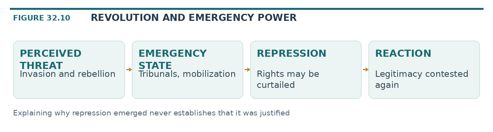

Революционните закони и преживявания надживяха промените в режима. Краят на корпоративната привилегия, новите административни форми, дебатите за светската власт, легалното равенство за мъжете в много контексти и идеята, че гражданите могат да бъдат мобилизирани за национална война се оказаха трайни или влиятелни. Наполеонското управление консолидирало някои промени, докато обръщали или ограничавали другите и изграждали една авторитарна империя. Полезният въпрос не е само дали революцията е успяла, но и кои конкретни трансформации са продължили и за кого.

Френски армии и администратори пренасят революционни и Наполеонови институции в други части на Европа, често чрез принуда. Заетото население не е получило тези трансформации като неутрални дарове. Някои приветстваха реформите в собствеността, закона или привилегията; други се съпротивляваха на реквизициите, данъците, абонамента и външния контрол. Последвалите конфликти помогнаха за оформянето на по-късните национални и конституционни движения. Развитието на Европа ще се появи отново в 34 и 37 г.

<figure class="figure" id="figure-32-10">

<figcaption>Фигура 32.10. Обяснявайки защо са се появили репресии, никога не се установява, че това е оправдано. <a class="figure-anchor" href="#figure-32-10" aria-label="Link to this figure">#</a></figcaption>
</figure>

Френската революция също така излага на повтарящо се напрежение: движенията, които твърдят, че народният суверенитет изисква институциите да направят несъгласието поносимо. Без защитена опозиция, предсказуеми процедури и ограничения на извънредната сила правителството може да призове хората като оправдание за потискането на реалните хора. Този урок не е уникален за Франция, но Франция предлага особено концентриран исторически пример.
