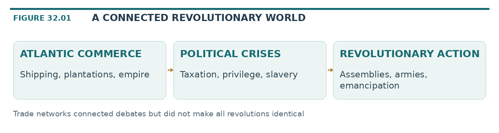

Атлантическият океан не се е превърнал в интегриран политически свят за една нощ. Както показват по - ранните глави, векове империя, търговско корабоплаване, производство на плантации, принудителна миграция и война свързали бреговете ѝ. До осемнадесети век, новини, книги, войници, търговски кредити, бежанци и политически аргументи могат да циркулират между Северна Америка, Карибите, Западна Европа и части от Африка. Конфликтът по отношение на данъчното облагане в едно пристанище може да засегне разходите за корабоплаване другаде; бунтът върху захарното имение би могъл да повлияе на страховете на собствениците на роби на хиляди километри разстояние.

Историците използват фразата "Атлантически революции," за да идентифицират свързаните политически трансформации от края на осемнадесети до началото на деветнадесети век. Категорията е полезна, но не трябва да заличава различните истории на коренното общество, Западна Африка или Латинска Америка. Нито пък идеите пътуват само в една посока, от европейски философи до пасивни колониални публика. Хората, които живеят под империята и особено тези, които се борят с робството, променят съдържанието и последствията от самия политически език.

<figure class="figure" id="figure-32-1">

<figcaption>Фигура 32.1. Търговските мрежи са свързани дебати, но не всички революции са идентични. <a class="figure-anchor" href="#figure-32-1" aria-label="Link to this figure">#</a></figcaption>
</figure>

Сравнителен подход задава четири въпроса на всяко движение. Първо, каква стара уговорка била оспорвана? Второ, кои групи имаха ресурсите да мобилизират? Трето, как войната и международната политика променили борбата? Четвърто, кой спечели смислени права след победата? Тези въпроси предотвратяват най-често срещаната грешка: ако приемем, че декларацията на революцията описва перфектно нейното общество. Документът е доказателство за претенция и стремеж; практическото разпределение на властта трябва да се разследва отделно.
