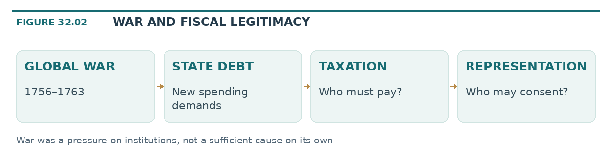

Седемгодишната война (1756 и 1763 г.) се води в цяла Европа, Северна Америка, Карибите и азиатските театри. В Северна Америка тя се припокриваше с конфликта, традиционно наречен Френската и Индийската война. Победите на Великобритания разшириха териториалните си претенции, но дойдоха с големи дългове и нови административни отговорности. Франция също се изправи пред трудни финанси и по-късната й намеса в американската борба постави допълнителен натиск върху кралските приходи. Така мащабната война свързва императорския успех с фискалната уязвимост.

Това е пример за по-широк исторически механизъм. Щатски заеми и данъци за финансиране на война. Новите приходи изискват гневни групи, които поставят под въпрос справедливостта на бремето и дали съгласието им има значение. Политическите власти се опитват да поддържат по-голям контрол; организираната съпротива може да наруши събирането и оспорва легитимността. Нито дългът, нито данъчното облагане автоматично причиняват революция: много правителства преживяват тежки дългове. Решителният въпрос е как финансовият натиск взаимодейства с институциите, социалните очаквания и възможностите за колективни действия.

<figure class="figure" id="figure-32-2">

<figcaption>Фигура 32.2. Войната беше натиск върху институциите, не е достатъчна причина за това. <a class="figure-anchor" href="#figure-32-2" aria-label="Link to this figure">#</a></figcaption>
</figure>

За Великобритания и нейните колонии, края на войната също повдигна западни териториални спорове. Кралската прокламация от 1763 се опита да регулира селището западно от Апалачите планини, но колонисти, земя спекуланти, както и местни народи имаха противоречиви интереси. Местните народи не били просто наблюдатели на англо-американски аргумент. Тяхното върховенство и териториално оцеляване били от основно значение за разширяващата се империя, въпреки че революционната реторика на по-късните години често ги пренебрегвала.
