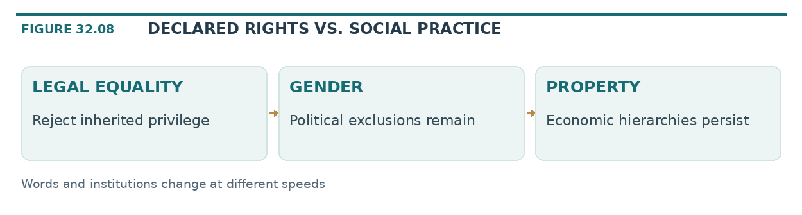

През октомври 1789 г. хиляди жени и други демонстранти маршируват от Париж към Версай, протестирайки срещу недостиг на хляб и политически условия. Кралското семейство било доведено в Париж, поставяйки монархията под по-голям обществен натиск. Походът показва, че материалните нужди и политическите действия не могат да бъдат разделени. Търсенето на хляб не беше доказателство за невежество спрямо политиката; настояваше легитимният режим да отговори на нуждите на хората, чийто труд го поддържаше.

Жените също организираха клубове, пишеха петиции, разискваха суверенитета и участваха в политически демонстрации. През 1791 г. Olympe de Gouges публикува декларация за правата на жената и на женския гражданин, моделирана върху декларацията за правата от 1789 г. и насочена срещу изключването на жените. Нейната намеса не беше единственият феминистки глас на периода, но тя осигурява необичайно ясен първичен текст за сравняването на универсални претенции с половите граждани.

<figure class="figure" id="figure-32-8">

<figcaption>Фигура 32.8. Думите и институциите се променят с различна скорост. <a class="figure-anchor" href="#figure-32-8" aria-label="Link to this figure">#</a></figcaption>
</figure>

Революционистите не се съгласиха как да признаят жените за политически актьори, а по - късно женските политически клубове бяха потиснати. Намаляването на периода до неусложнено разширяване на правата прикрива този обрат. За едно учение сравни официалните правни граници на гражданството с формите на влияние, които се предлагат чрез протест, публикуване, благотворителност и мрежи за домакинство. Хората биха могли да бъдат политически активни, без да се ползват от пълни официални права.
