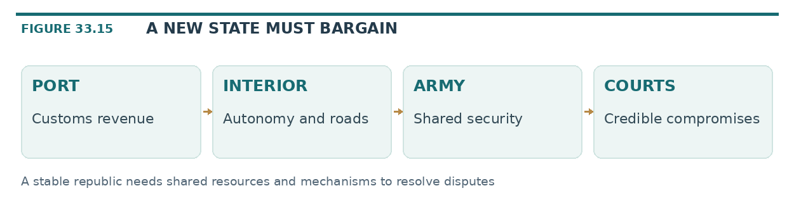

Да разгледаме измислена република от три провинции след дълга война за независимост. Крайбрежният капитал контролира основната митническа къща и събира 70 единици приходи. Две вътрешни провинции заедно събират 30. Националната отбрана и съдилища изискват 80 единици, докато провинциите искат пътища, училища и автономия над местните милиции. Крайбрежният капитал предлага изпращането на 60 единици в централна хазна. Вътрешният управител се страхува, че назначенията и договорите ще облагодетелстват пристанището, докато вторият губернатор твърди, че никоя провинция не може да оцелее само при чужда атака.

Всички страни имат разбираеми притеснения. Centralization може да подобри защитата и кредита, но може да се концентрира покровителството. Децентрализацията може да защити местното вземане на решения, но би могла да остави едно общо правителство неспособено да наложи споделени решения. Търговците на пристанището се възползват от националната стабилност, но могат да устоят на по-високи мита, които намаляват търговията. Селските земевладелци искат пътища, но се противопоставят на прякото данъчно облагане. Генерал с неплатени войници може да се намеси независимо какво казва конституцията.

<figure class="figure" id="figure-33-15">

<figcaption>Фигура 33.15. Една стабилна република се нуждае от общи ресурси и механизми за разрешаване на спорове. <a class="figure-anchor" href="#figure-33-15" aria-label="Link to this figure">#</a></figcaption>
</figure>

Числата са изградени предположения за преподаване, а не данни от истинска латиноамериканска република. Тяхната цел е да превърнат абстрактните фрази федерализъм, caudillismo, фискална слабост и решения с разпродажби. Една дълготрайна държава изисква правила за споделяне на приходи, надеждно решаване на спорове, граждански контрол над въоръжените сили и политическа готовност да загубим гласуване, без да изоставяме съюза.
