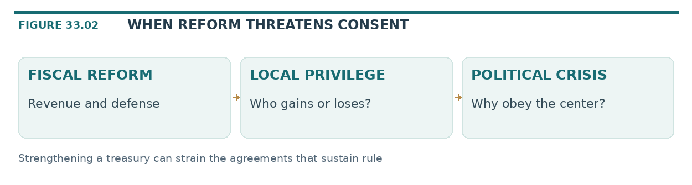

След скъпи войни и стратегически поражения Испания се опитала да направи американските си притежания по-продуктивни и защитени. Трансформациите в Бурбон през 18-ти век реорганизираха територии, увеличиха някои административни възможности, затегнаха събирането на приходи и насърчиха избрани търговски промени. Новите или преразгледани данъци засягат търговията и потреблението; военните и бюрократичните инициативи зависят от колониалните ресурси. Реформата не беше единна. Някои пристанища са получили търговски възможности, докато определени производители, длъжностни лица и корпорации се страхуват от изгубени привилегии или нарастващ контрол.

Отговорът беше еднакво неравен. Колониалните икономики не бяха нито еднакво застояли, нито равномерно проспериращи. Сребърните мини в Мексико и Перу, селскостопанската търговия, занаятчийската промишленост и атлантическа търговия създадоха богатство, но колониалните фискални изисквания разпределяха неравномерно тежестите. В цялата империя местните хора оценяват реформите чрез живи въпроси: Дали би изисквал повече бирник? Ще получи ли съперник търговец достъп до пазара? Ще загуби ли една местна общност стара защита? Офицер от милицията ще получи ли статус?

<figure class="figure" id="figure-33-2">

<figcaption>Фигура 33.2. Укрепването на хазната може да обтегнат споразуменията, които поддържат управлението. <a class="figure-anchor" href="#figure-33-2" aria-label="Link to this figure">#</a></figcaption>
</figure>

Появява се полезен причинен урок. Една реформа може да укрепи ресурсите на империята, като същевременно отслаби политическите споразумения, които правят тази империя управляема. Фискалните оплаквания сами по себе си не доведоха до независимост. Те станаха взривоопасни, когато се комбинират с оспорван суверенитет, война, съществуващи неравенства и възможности за регионалните групи да се организират.
