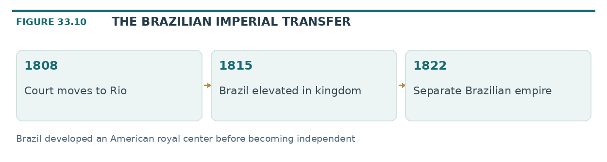

Бразилия следвала необичайно отличителен път. Изправен пред нахлуването на Наполеон в Португалия, португалският съд се прехвърлил в Рио де Жанейро през 1808 г., превръщайки един голям американски град във временно място на европейска монархия. Кралски институции, администратори и нови търговски договорености се движат или развиват в Бразилия. През 1815 г. официалният статут на Бразилия е повишен в Обединеното кралство Португалия, Бразилия и Алгарвес. Този опит променя отношенията между португалския императорски център и американските му територии.

Когато една конституционна революция в Португалия през 1820 г. оспори стария ред, се появиха противоречиви искания за това дали Бразилия отново трябва да бъде управлявана предимно от Лисабон. Принц Педро остава в Бразилия и провъзгласява независимост през 1822 г., той става император Педро I. Независимост не е нито универсално мирен, нито неоспорими. Въоръжените конфликти продължиха в няколко провинции, включително и Баия, а местните елити не бяха съгласни с новите монархии.

<figure class="figure" id="figure-33-10">

<figcaption>Фигура 33.10. Бразилия разработи американски кралски център, преди да стане независима. <a class="figure-anchor" href="#figure-33-10" aria-label="Link to this figure">#</a></figcaption>
</figure>

Затова Бразилия показва, че независимостта не изисква непременно незабавното премахване на монархията. Съдът, който вече се беше преместил през Атлантическия океан, предложи основа за нов императорски център в Рио, докато конституционните дебати и съпротивата оформиха получената държава. Продължаванията бяха толкова важни, колкото и официалното прекъсване с Португалия.
