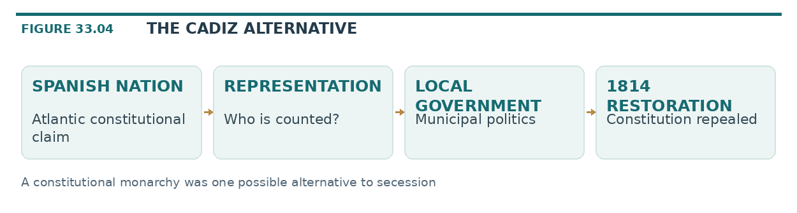

Докато войната срещу Наполеон продължи в Испания, представители свикани в Кадис и произведени Конституцията на 1812. Тя представя конституционна монархия и испанска нация, която обхваща двете страни на Атлантическия океан, докато структурира представителство, политически права и местно управление по спорен начин. Това не беше просто европейски документ, наложен на пасивните американци. Делегатите и аргументите от американските територии бяха част от конституционния дебат, макар че дистанцията и изборните договорености ограничиха представителството.

Споразумението от Кадис въведе възможна алтернатива на окончателното разделяне: реформирана трансатлантическа монархия с конституционни институции. Нейните предположения за гражданството и социалните категории са иновативни и изключващи. Въпросът за това как да се броят или включват хора от африкански произход, например, става особено спорен. Общинските избори и конституционният език предлагат на някои местни общности нови политически стратегии, като същевременно застрашават по-старите юрисдикции.

<figure class="figure" id="figure-33-4">

<figcaption>Фигура 33.4. Конституционната монархия била една възможна алтернатива на отцепването. <a class="figure-anchor" href="#figure-33-4" aria-label="Link to this figure">#</a></figcaption>
</figure>

Възстановяването на Фердинанд VII през 1814 доведе до отмяна на конституцията и подновен Абсолютистки опит за възстановяване на контрола, докато либералната революция в Испания през 1820 възстанови конституционното управление отново. Тези обрати засегнаха политическите изчисления в Мексико и другаде. Конституционната криза на империята не е кратка прелюдия към независимостта; тя остава част от самата независимост.
