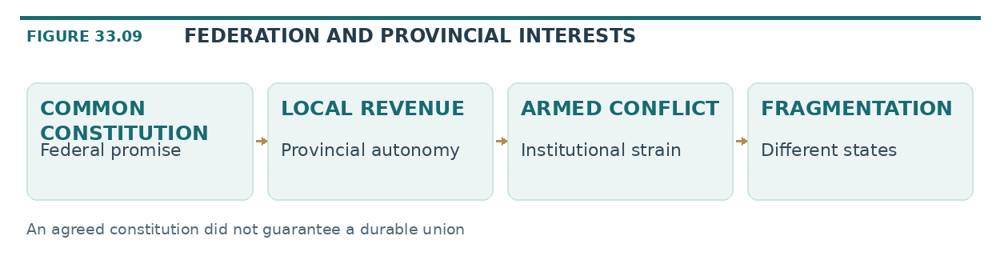

Провинциите на бившето кралство Гватемала обявяват независимост от Испания през 1821 г., след което имат кратка връзка с Мексиканската империя, преди да се появи отделен политически проект в Централна Америка. През 1823 г. е създадена федерация, която свързва територии, съответстващи на днешна Гватемала, Ел Салвадор, Хондурас, Никарагуа и Коста Рика. Нейните лидери са изправени пред спорове за федерализъм, провинциална автономия, религия, данъчно облагане и контрол над военните сили.

Федерацията притежаваше конституция и език на общо гражданство, но страните-членки се различаваха в икономиката, местните енергийни мрежи и идеи за това кой трябва да управлява. Бедният транспорт и несигурните приходи направиха общите институции скъпи. Конфликтът между либерални и консервативни политически коалиции се преплита с регионални съперници и въоръжени борби. До края на 1830 г. и началото на 1840 г. федерацията се е разпаднала.

<figure class="figure" id="figure-33-9">

<figcaption>Фигура 33.9. Договорената конституция не гарантира траен съюз. <a class="figure-anchor" href="#figure-33-9" aria-label="Link to this figure">#</a></figcaption>
</figure>

Би било неточно да се нарече тази история просто провалена имитация на Съединените щати. Централните американци обсъждаха законната власт в собствените си колониални наследства, системи за задържане на земя и фискални ограничения. Тяхната федерация беше истински политически вариант, а не второстепенно отклонение преди да се появят пет модерни държави. Тя показва как независимостта би могла да създаде нови възможности, като същевременно направи мястото на окончателния суверенитет ожесточено оспорвано.
