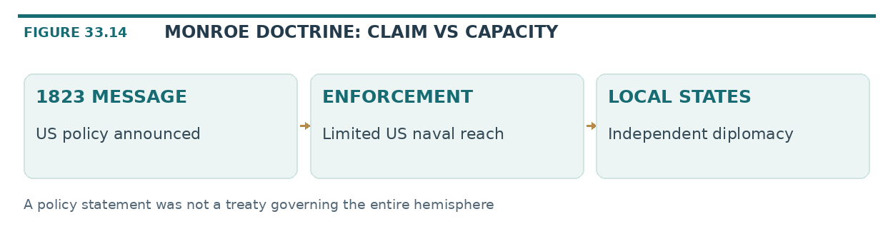

Новите държави също се нуждаеха от дипломатическо признаване и достъп до международна търговия. Великобритания често преследваше търговски възможности и се опитваше да ограничи съперническото европейско влияние, без непременно да предвижда пряко териториално завоевание. Признаването било политическо и можело да бъде бавно или условно. Испания не прие незабавно независимостта на всяка бивша колония и конституционните и дипломатически условия в Европа продължиха да имат значение.

В Съединените щати съобщението на президента Джеймс Монро от 1823 г. до Конгреса обяви политика, която се противопоставя на по-нататъшната европейска колонизация и някои форми на намеса в Америка. То се нарича Доктрината на Монро. По онова време Съединените щати разполагали с ограничени правомощия да го наложат в цялото полукълбо, а британската морска сила помогнала за възпирането на някои европейски начинания. Доктрината е политическа претенция на САЩ, а не договор, подписан от новите латиноамерикански страни.

<figure class="figure" id="figure-33-14">

<figcaption>Фигура 33.14. Изявлението на политиката не беше договор, уреждащ цялото полукълбо. <a class="figure-anchor" href="#figure-33-14" aria-label="Link to this figure">#</a></figcaption>
</figure>

Разликата предотвратява анахронизма. По-късно Съединените щати станаха много по-влиятелни, но силата си през 1823 не трябва да се представя като идентичен на неговата сила един век по-късно. Латиноамериканските дипломати и политически лидери преследваха собствените си цели, притесняваха се за възстановяването на Европа и понякога не вярваха в амбициите на съседните държави. Международната система оформи независимостта без да определя всеки вътрешен избор.
