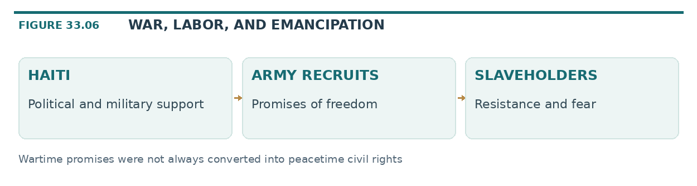

Хаити, независима от 1804 г. насам, играе важна роля в по-широката политика на свобода в Атлантическия океан. През 1815 и 1816 г. Боливар получава подкрепа в Хаити, включително от президента Александър Петион, а въпросът за еманципацията се заплита с военна помощ и политическа легитимност. Подробностите за техния обмен трябва да бъдат разгледани чрез оцеляване на кореспонденцията и по-късни акаунти, вместо героични анекдоти. И все пак по-широкият въпрос е ясен: революцията в Хаити влияе на дебатите за робството и суверенитета на континента.

Обещанието за свобода също се сблъска с мощни икономически интереси. Поробеният труд остава важен на места като крайбрежна Венецуела, Колумбия, Куба и Бразилия, макар че мащабът и формите му се различават. Свободните хора от африкански произход имали професии, общности и политически амбиции, които не зависели от нито един революционен лидер. Някои собственици на роби приели независимостта, докато се противопоставяли на еманципацията, а други приемали постепенна правна промяна под натиска на войните и политическите преговори.

<figure class="figure" id="figure-33-6">

<figcaption>Фигура 33.6. Войната обещаваше не винаги да се превръща в мирни граждански права. <a class="figure-anchor" href="#figure-33-6" aria-label="Link to this figure">#</a></figcaption>
</figure>

Примерът на Хаити също предизвика страх сред робовладелците елити. Същата революция може да се отбележи като доказателство за антиколониална свобода и осъден като заплаха за собствеността и расовата йерархия. Тези противоречиви реакции са от съществено значение за разбирането защо законът за робството се е променил неравномерно в Латинска Америка през 19 век и защо независимостта на една страна никога не трябва да се бърка с освобождаването на всички нейни жители.
