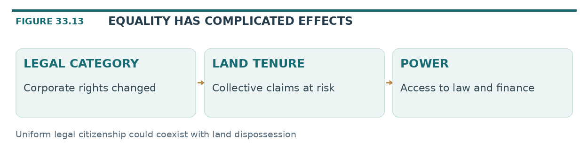

Независимостта даде възможност да се оспорват колониалните правни различия, но практическите последици за коренното население бяха противоречиви. Някои конституции обещаха равенство между гражданите. Въпреки това реформите биха могли да премахнат колективните правни категории или общи защитни мерки, без да се предоставят на общностите защитени права на земята или смислено политическо влияние. Законопроектантите понякога си представяли единен гражданин и третирали местните езици и институции като пречки пред модернизацията.

Други актьори се борили да запазят селските земи, местната автономия и признатите обичайни договорености. Общностите могат да подават петиции до съдилища, да преговарят за военни съюзи, да се противопоставят на данъчното облагане или да се присъединят към регионални бунтове. Тяхната позиция зависела от местните модели на собственост, силата на колективните институции и отношенията им с провинциалните правителства. Местните хора не просто реагираха; те формираха възможностите и границите на държавното формиране.

<figure class="figure" id="figure-33-13">

<figcaption>Фигура 33.13. Униформено юридическо гражданство може да съществува едновременно с отнемането на земя. <a class="figure-anchor" href="#figure-33-13" aria-label="Link to this figure">#</a></figcaption>
</figure>

Важно аналитично разграничение е официалното равенство спрямо ефективната защита. Премахването на закон, който бележи общността като законно отделна, може да разшири едно право, докато излага земята си на могъщи частни купувачи. Обратно, запазването на колективна институция може да защитава ресурсите, като същевременно поддържа и някои неравно третиране. Няма просто уравнение, в което всяка политика с етикет либерал автоматично да произвежда по-голяма свобода за всички.
