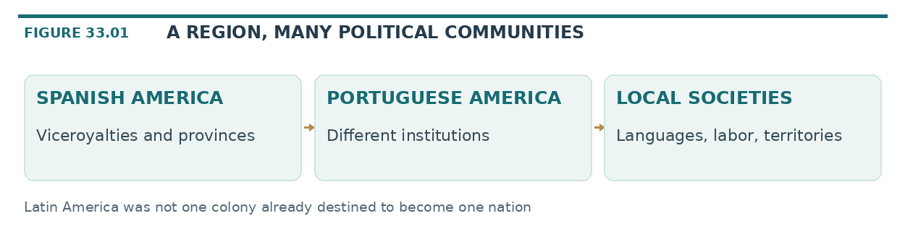

Етикетът Латинска Америка е полезен за обсъждане на части от Америка, оформени дълбоко от испански, португалски и френски езици и институции. Това обаче е ретроспективен регионален термин, който не се споделя еднакво от ранните жители на ХІХ век. Испанската монархия управлявала обширни, но различни организирани юрисдикции: Нова Испания, Нова Гранада, Перу и Рио де ла Плата; генерални капитани и провинциални правителства; кралски съдилища, наречени одиенций; общини; и църковни институции. Португалската Америка развива различна административна и търговска история. Карибските острови включваха места, чиито политически фючърси се различаваха драстично от тези на континента.

Географията е усилена. Планинските селища в центъра на Мексико и Андите не са управлявани и доставени по същия начин, както равнините за отглеждане на добитък, Амазонските граници, тихоокеанските пристанища или карибските плантации. Планините могат да разделят армиите и провинциите; реките и морските пътища биха могли да обединят търговските интереси през политическите граници. Населението се различавало от населението в историята на местната автономия, африканското робство, европейската миграция, смесените предци, земевладелството и окупацията. Един лозунг, провъзгласен в една столица, може да означава малко за едно село, което е изправено пред изисквания за войници и зърно.

<figure class="figure" id="figure-33-1">

<figcaption>Фигура 33.1. Латинска Америка вече не е една колония, предопределена да стане една нация. <a class="figure-anchor" href="#figure-33-1" aria-label="Link to this figure">#</a></figcaption>
</figure>

Ето защо войните за независимост се отнасят до припокриващи се борби, нито една координирана латиноамериканска кампания. Историците сравняват регионите, за да идентифицират общите механизми на кризата, конкуренцията над суверенитета, фискалния натиск, мобилизацията, но те също трябва да проследят местните съюзи и разногласия. Богат земевладелец, свободен чернокож занаятчия, селски местен лидер и поробен работник биха могли да използват езика на свободата, докато търсят доста различни резултати.
