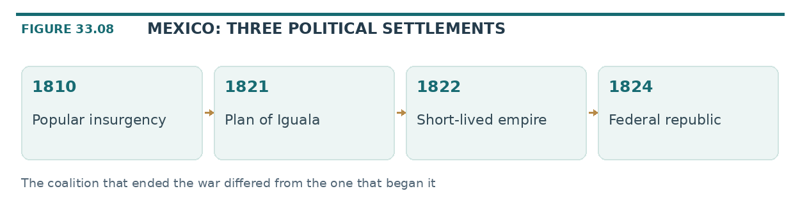

Последният пробив с Испания се оформя на фона на обновената конституционна криза на монархията след 1820 г. Консервативните притежатели на собственост и религиозни актьори, които се противопоставиха на по-ранните бунтовници, сега имаха основания да се противопоставят на либерален конституционен ред в чужбина. Аугустин де Итурбид, преди това офицер, борещ се за короната, преговарял с бунтовника Висенте Гереро. Планът на Игуала през 1821 г. насърчава независимостта, католическата религия и единството по монархическа формула, въпреки че значението на нейните обещания се различавало сред поддръжниците.

Армията на трите гаранции напредна в селището, а Мексико стана независима през 1821. Итурбид е коронован император през 1822 г., но империята скоро се изправи срещу опозицията и рухна през 1823 г. Федералната конституция от 1824 г. откри републиканска рамка. Това бързо преминаване от монархия към република прави полезно сравнение с Бразилия, чиято имперска монархия продължи много по-дълго.

<figure class="figure" id="figure-33-8">

<figcaption>Фигура 33.8. Коалицията, която сложи край на войната, се различаваше от тази, която започна. <a class="figure-anchor" href="#figure-33-8" aria-label="Link to this figure">#</a></figcaption>
</figure>

Мексиканският случай показва важна разлика между бунтовете, които започват революция и коалицията, която завършва прехвърлянето на суверенитет. Различни групи могат да се присъединят към движението за независимост в различни моменти, търсейки различни институции. Гледайки само към окончателното споразумение прикрива социалните конфликти, които са го направили възможно; гледайки само на първото въстание, се крие защо окончателното споразумение е придобило неочаквана форма.
