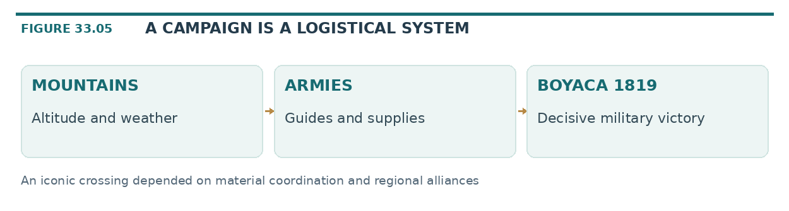

През 1819 Боливар ръководи кампания през труден Андски терен в Нова Гранада. Патриотичната победа в Бояка през август беше решаваща за контрола над Богота и засили проекта за обединяване на Венецуела и Нова Гранада. Логистиката е важна тук. Войници и животни са изправени пред височина, студ, кални пасове, болести и недостиг на доставки. Сметките, които празнуват брилянтния командир, са непълни, освен ако не признават и местните водачи, транспортните работници, вербуваните бойци и политическата организация, необходима за поддържането на силите.

Новата Република Колумбия, обикновено наречена Гран Колумбия от по-късните историци, за да я разграничат от съвременната страна, обединява територии, които са широко свързани с днешна Колумбия, Венецуела, Еквадор и Панама. Конституцията на Кукута през 1821 г. се стреми да организира централно правителство и да определи правата и службите на гражданите. Републиката е съществувала като спорен политически проект, а не като културно хомогенна нация, която чака да бъде обединена.

<figure class="figure" id="figure-33-5">

<figcaption>Фигура 33.5. Една емблематична кръстоска зависела от материалната координация и регионалните съюзи. <a class="figure-anchor" href="#figure-33-5" aria-label="Link to this figure">#</a></figcaption>
</figure>

Военните кампании продължиха с изместването на контрола в региона. В Карабобо през 1821 г. патриотичните сили осигуряват голяма победа във Венецуела. На територията на днешния Еквадор победата на Антонио Хосе де Сукре в Пичинча през 1822 г. била решаваща за Кито. Тези борби зависели от мултинационални армии и комплексни местни съюзи, а по-късно патриотични възпоменателни събития могат да замъглят импровизационния характер.
