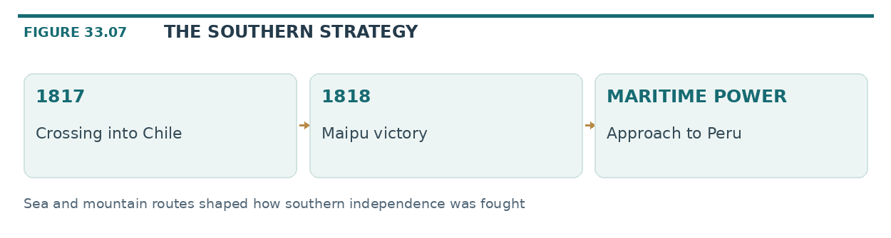

Хосе де Сан Мартин, опитен офицер, който служил в Испания, станал център на кампаниите в южната половина на Южна Америка. Вместо да разчита единствено на надземна тяга от Рио де ла Плата към роялистки крепости в Горен Перу, той помага за организирането на армия в региона Куйо и пресича Андите в Чили през 1817 г. Този стратегически избор включваше обучение, планинска логистика, разузнаване и координация с чилийските патриоти, включително Бернардо О'Хигинс.

Победата в Чакабуко през 1817 г. укрепва патриотичната позиция; битката при Майпун през 1818 г. консолидира чилийската независимост след подновена военна опасност. Самият кръстопът заслужава анализ отвъд славата си: високи планински граници пътища, глутница животни носят ограничени доставки, и времето може да наруши комуникациите. Военният успех идва от планирането и социалната мобилизация, колкото и индивидуалната смелост.

<figure class="figure" id="figure-33-7">

<figcaption>Фигура 33.7. Морето и планинските маршрути оформят как се води южната независимост. <a class="figure-anchor" href="#figure-33-7" aria-label="Link to this figure">#</a></figcaption>
</figure>

След това Сан Мартин подкрепил морска кампания към Перу, където вицекралската администрация останала основен кралски център. Флотът, договорите за корабоплаване, крайбрежните бази и политическите обещания били важни колкото победите на бойното поле. Южняшката кампания показва защо не се отчита независимост, ограничена само до наземни битки, може да обясни как властта е сменила ръцете си по крайбрежието на Тихия океан.
