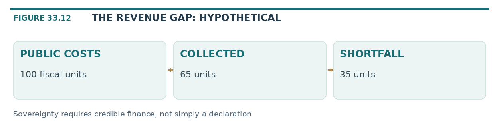

Една имперска система може да движи приходите между териториите, за да финансира администрацията, армиите и отбраната. Независимостта наруши тази уговорка. Минните райони претърпяха военни щети, полета и пътища бяха опустошени, търговията намаля в някои области, а колониалните фискални механизми загубиха легитимност или капацитет. Въпреки това новите правителства се нуждаеха от пари, за да плащат на длъжностните лица, да защитават границите, да създават съдилища и да почетат дълговете. Гражданите могат да приемат независимостта, като се противопоставят на данъците, свързани със стария режим.

Митата станаха особено привлекателни, защото можеха да бъдат събрани на пристанища, където стоките физически преминават. Но митническите приходи бяха неравномерно разпределени. Пристанищният град може да стане политически могъщ, докато вътрешните провинции смятат хазната за нечестно концентрирана. Правителствата назаем у дома и в чужбина, понякога с условия, които по-късно ограничаваха избора. Заемането на заеми може да помогне за поддържането на държавата в кризисна ситуация, но обслужването на дълга намали наличните ресурси за пътища, образование и обществен ред.

<figure class="figure" id="figure-33-12">

<figcaption>Фигура 33.12. Суверенността изисква надеждно финансиране, а не просто декларация. <a class="figure-anchor" href="#figure-33-12" aria-label="Link to this figure">#</a></figcaption>
</figure>

Да разгледаме един опростен пример: една република се нуждае от 100 единици годишно за войници, съдии и пътища, но събира само 65. Ако тя заема 35 всяка година без ръст на приходите или намалени разходи, дългът се натрупва и кредиторите в крайна сметка изискват висок лихвен процент или спират кредитирането. Данните са хипотетични. Въпросът е, че суверенитетът изисква повече от знаме; той изисква административна система, способна да трансформира колективните решения в надеждни ресурси.
