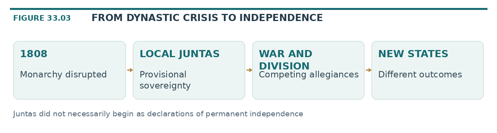

През 1808 Наполеон интервенции и принудителни абдикация в Bayonne подкопава испански монархия признати център. Съпротивата срещу френското владичество в Испания произвежда регионални хунтас и временни управителни органи, които твърдят, че действат в отсъствието на законния крал. Колониалните градове били изправени пред дилема: били ли са задължени да се подчиняват на определен полуостровен хунта или биха могли да упражняват същото право да управляват себе си, докато царската власт бъде възстановена?

В цяла испанска Америка местните съвети и политически групи разискваха какво означава суверенитет. Някои места създава хунтас през 1809 или 1810; други ги отхвърля, или осцилирани между лоялност и автономия. Участието често беше съсредоточено сред градските елити, но войните и местните политически преговори разшириха участниците. Една хунта не е непременно декларация за постоянна независимост. Може да се твърди, че управлява в името на краля, докато отказва властта на друго регионално правителство.

<figure class="figure" id="figure-33-3">

<figcaption>Фигура 33.3. Юнтас не е задължително да започва като декларация за постоянна независимост. <a class="figure-anchor" href="#figure-33-3" aria-label="Link to this figure">#</a></figcaption>
</figure>

Разликата е фундаментална. Автономията означава вземане на решения на местно равнище в рамките на или заедно с по-широк политически ред; независимостта означава отстояване на суверенитета отделно от този ред. Политическите движения могат да пътуват от първи до втори, когато обстоятелствата се променят. Третирането на всяка хунта като националистическа държава от раждането налага по-късно национални разкази в много по-несигурен исторически момент.
