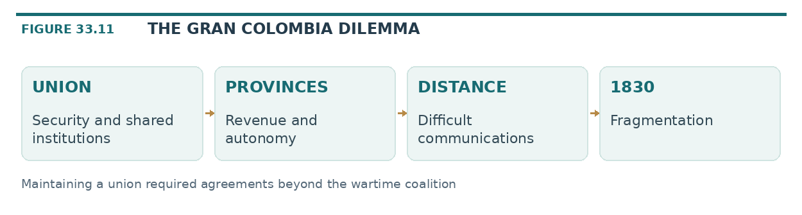

Съюзът, свързан с Боливар, беше амбициозен, но политическата география на Северна Южна Америка представи основните бариери. Каракас, Богота, Кито и други центрове притежавали различни търговски връзки и традиции. Планините и дългите разстояния правят комуникацията бавна. Провинциалните елити се опасяваха, че силна централна администрация може да пренасочи ресурсите и назначенията си от тях. Военните командири с военновременен престиж биха могли да предизвикат граждански институции или да поискат регионална автономия.

До 1830 Гран Колумбия се разтваря в отделни политически образувания; Венецуела и Еквадор се появява като отделни държави, докато останалата република става предшественик на съвременна Колумбия и по-късно историята на Панама следва различен курс. Процесът не може да бъде обяснен само с разочарованието на един човек. Конституционният конфликт, фискалните интереси, местната идентичност и личната власт на командирите се укрепват взаимно.

<figure class="figure" id="figure-33-11">

<figcaption>Фигура 33.11. Поддържането на съюз изисква споразумения отвъд военновременната коалиция. <a class="figure-anchor" href="#figure-33-11" aria-label="Link to this figure">#</a></figcaption>
</figure>

Разпокъсаността също не доказва, че в Латинска Америка няма културен капацитет за единство. В региона бяха включени множество законни проекти за политическо членство и реални конфликти относно това кой трябва да облага, съди, вербува и легализира. Федерация или съюз оцелява само когато нейните компоненти вярват, че споделените ползи надвишават разходите за предаване на някои правомощия за вземане на решения. Това изчисление се променя с края на войните и извънредните коалиции губят общия си враг.
