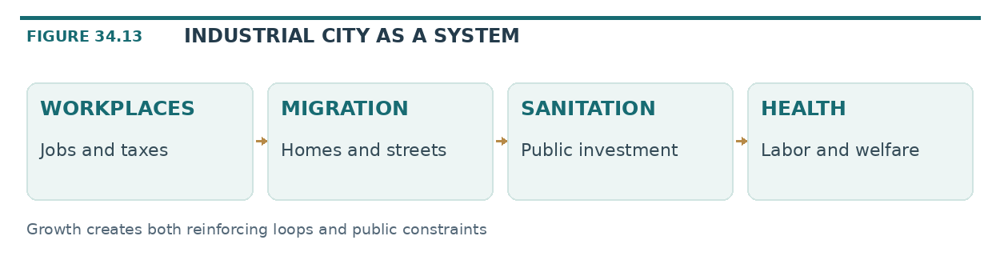

Да разгледаме нуждите на растящ индустриален град. Фабриките се нуждаят от гориво, работници, вода и пътища. Работниците се нуждаят от храна, жилища и транспорт. Домакинствата генерират отпадъци; улиците изискват дренаж; търговията се нуждае от докове и складове; работодателите се нуждаят от кредит и застраховка; семействата търсят училища и места за поклонение. Нито един от тези компоненти не функционира напълно сам. Провалът в единия може да отслаби другите: наводненията прекъсват пътищата, холерата намалява работната сила и неадекватната гъстота на населението.

Това е практичен пример за мислене на системите от глава 7. Можем да привлечем още повече работници, чиито разходи привличат повече магазини и услуги и уравновесяването на трафика увеличава наема, замърсяването вреди на здравето и скъпото разширяване на транспорта. Местните правителства са изправени пред избор за данъчно облагане, дълг, обществени поръчки и които са се възползвали от подобряване. Частните доставчици понякога доставяха основни услуги, но техните стимули не винаги се съгласуваха с универсалния достъп.

<figure class="figure" id="figure-34-13">

<figcaption>Фигура 34.13. Растежът създава както усилващи се контури, така и обществени ограничения. <a class="figure-anchor" href="#figure-34-13" aria-label="Link to this figure">#</a></figcaption>
</figure>

Поради това индустриалният град промени възможностите и границите на политическата власт. Градските съвети и националните правителства биха могли да използват планови, хигиенни и трудови правила за намаляване на колективните рискове. Те можели също така да привилегировани собственици на имоти, да изместят по - бедните жители или да направят работниците по - видими за полицията. Градската инфраструктура е оспорвано разпределение на разходите и ползите, а не само неутрален набор от тръби и пътища.
