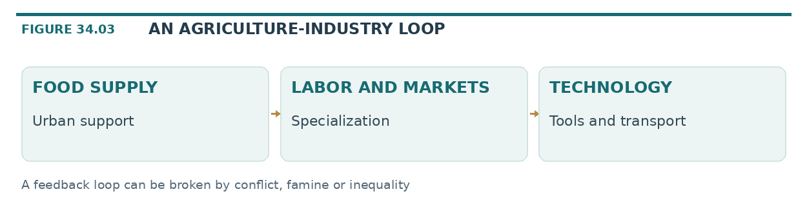

Земеделската промяна и индустриализацията си влияеха един на друг. По-добър дренаж, селективно размножаване, промени в ротацията на културите и земеползването, подобрен транспорт и нови търговски отношения биха могли да подпомогнат по-големите населени места в градовете чрез производство и разпространение на храна по-ефективно. Но нито една "селскостопанска революция" не се е случвала навсякъде на една среща. Консолидацията или приватизацията на някои споделени и открити права се възползват от някои земеделски стопани и наемници, като същевременно намаляват достъпа до ресурси за други. Нейната времева рамка, регионална степен и отношения с миграцията остават обект на научни изследвания.

Растежът на населението разшири потенциалните пазари за облекло, домакински предмети и гориво. Тя може също така да увеличи кръга от работници, които търсят заплати. Нарастващото търсене не генерира автоматично фабрики: потребителите все още се нуждаят от покупателна способност, търговците се нуждаят от маршрути, а производителите се нуждаят от работещи технологии. Производството, земеделието и търговията създадоха обратна връзка. Градовете изисквали зърно и млечни продукти; селските райони купували железни инструменти и плат; железопътните линии в крайна сметка намалили разходите за преместване и на двете.

<figure class="figure" id="figure-34-3">

<figcaption>Фигура 34.3. Обратната връзка може да бъде прекъсната от конфликти, глад или неравенство. <a class="figure-anchor" href="#figure-34-3" aria-label="Link to this figure">#</a></figcaption>
</figure>

Проста диаграма илюстрира механизма, а не универсална причинно-следствена последователност. По-надеждните хранителни запаси могат да подкрепят градската концентрация. Градската концентрация може да задълбочи трудовата специализация. Специализацията може да разшири пазарите за нови машини и транспорт. Тези технологии от своя страна могат да подобрят селското стопанство. Но всяка връзка може да се провали при лоша реколта, епидемии, война, неравенство или политически бариери. Индустриализацията беше променяща се система, а не стрела от поземлена реформа към фабрики.
