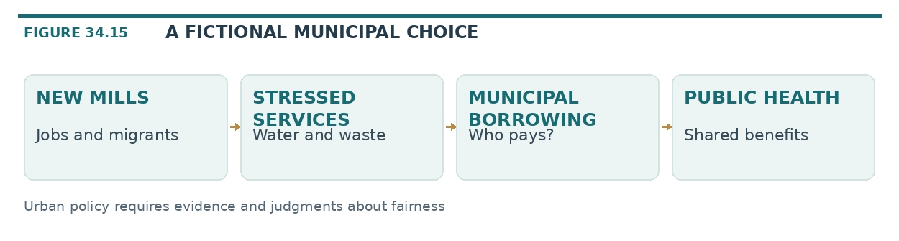

Представете си измислен индустриален град с 40 000 жители. Две нови мелници планират да наемат 1000 работници, като привличат може би 3000 допълнителни жители, когато са включени домакинства и обслужващи работници. Местните хазяи приветстват търсенето на стаи; продавачите очакват продажби; фабриките искат надеждна вода. Но кладенците и дренажа на града вече се борят, а реката получава отпадъци от домове и работилници. Съветът трябва да реши дали да вземе заем за проект за водопроводни работи и канализация. Тези цифри са хипотетични и не идват от определена историческа община.

Очевидно проблемът е финансов, но по-дълбокият въпрос е разпределението. Собствениците на големи имоти могат да предпочитат ниски данъци, ако техните къщи вече имат частна вода. Наемателите могат да се възползват най - много от подобренията, но нямат никакъв политически глас. Бизнесът иска достатъчно здрави работници да работят надеждно. Заемът създава незабавна обществена отговорност, а по-късно може да се появи намалена болест и по-високи стойности на земята. Кой може да гласува, кой плаща цени и кой контролира договорите имат значение колкото инженерния дизайн.

<figure class="figure" id="figure-34-15">

<figcaption>Фигура 34.15. Градската политика изисква доказателства и преценки за справедливостта. <a class="figure-anchor" href="#figure-34-15" aria-label="Link to this figure">#</a></figcaption>
</figure>

Разумното решение изисква няколко вида доказателства: разходите за тръби и поддръжка, процента на болести по водните пътища, демографски прогнози, собственост върху земята, данъчен капацитет и алтернативи. Тя изисква също така съдебни решения относно справедливостта и публичното задължение. Този случай обединява икономиката, историята, градското планиране и политическата философия. Индустриалната революция създаде не само фабрики, но и повтарящи се дилеми за колективно инвестиране в съвместно бъдеще.
