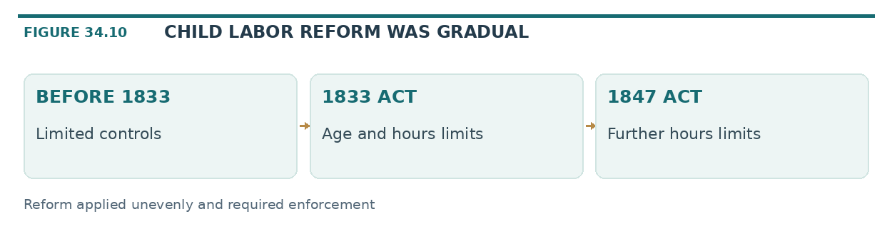

Децата са работили в селското стопанство, търговията с домакинствата, домашните услуги и работилниците много преди механизираните фабрики. Индустриализацията промени местоположението, мащаба, надзора и опасностите на някои форми на детски труд. Децата могат да посещават машини, да пренасят материали, да работят под земята или да помагат на семейния бизнес. Някои родители зависели от заплатата си за наем и храна. Бедността и ограничените образователни възможности бяха важни причини, докато работодателите получаваха евтини и често плавен труд. Нито семейните нужди, нито правните обичаи правят опасната работа безобидна.

Британският Фабричен закон от 1833 г. ограничава заетостта в текстилните фабрики, забранява заводската заетост на деца под девет години, ограничава часовете за по-големи деца и създава инспекторат. Законът от 1847 г. за десетте часа допълнително ограничава работата на жените и младите хора в определени текстилни условия. Тези закони се развивали с течение на времето, прилагали се към определени работни места и били несъвършено прилагани. Те не прекратиха незабавно детския труд във всички професии и не трябва да се бъркат с универсално задължително обучение или цялостна съвременна защита на труда.

<figure class="figure" id="figure-34-10">

<figcaption>Фигура 34.10. Реформата се прилага неравномерно и изисква принудително изпълнение. <a class="figure-anchor" href="#figure-34-10" aria-label="Link to this figure">#</a></figcaption>
</figure>

Историческото сравнение изисква грижи. Снимка на деца в мина ни казва нещо силно за работата, но нейното по-широко значение зависи от датата, местоположението, задачата, часа и алтернативите. Фабричните записи могат да се броят неофициално. Парламентарните показания могат да разкрият злоупотреби, но са събрани в настройки, оформени от кампании за реформи и политически цели. Комбинирайте лични показания, заплати, преброяване на доказателства, закони и правоприлагащи документи, вместо да позволите един драматичен образ да се застъпи за всяко индустриално детство.
