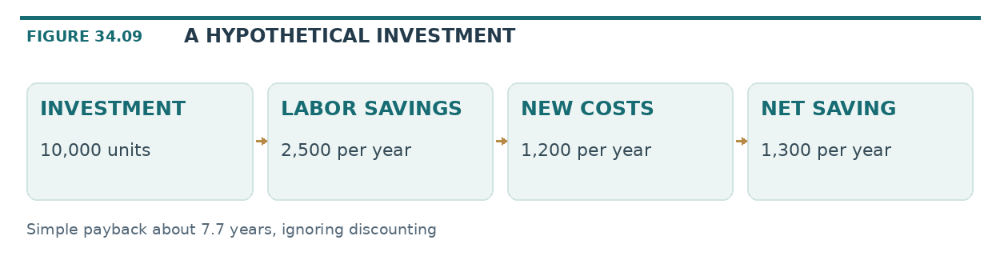

Машините струват пари, преди да произведат нещо. Индустриалистите се нуждаеха от сгради, двигатели, суровини, заплати, резерви за поддръжка и търговски взаимоотношения. Някои финансираха бизнеса си от семейно богатство или задържана печалба; други разчитаха на партньорства, местни кредитори, банки, инвеститори и търговски кредити. Развитието на финансовите институции намали някои бариери пред разширяването, докато спекулативните мехурчета и неуспехите разкриха рисковете от бързи инвестиции.

Ролята на предприемача не трябва да се свежда до героично изобретение. Успешният производител може никога да не проектира машина, но би могъл да организира доставчици, да преговаря за кредит, да наема квалифицирани работници, да разрешава затруднения и да продава надеждни продукти. Технически впечатляващо изобретение би могло да се провали търговско, ако е скъпо за ремонт, липса на купувачи, изправени пред правни спорове или пристигнали преди необходимата инфраструктура. От друга страна, много печеливши подобрения са постепенно и трудно да се припишат към един известен индивид.

<figure class="figure" id="figure-34-9">

<figcaption>Фигура 34.9. Отмъщение около 7,7 години, игнориране на отстъпките. <a class="figure-anchor" href="#figure-34-9" aria-label="Link to this figure">#</a></figcaption>
</figure>

Да разгледаме хипотетична текстилна фабрика, инвестираща 10 000 парични единици в оборудване. Ако машината спестява 2500 единици разходи за труд годишно, но добавя 1200 броя в въглища, ремонти и финансиране, годишното нетно спестяване е 1300 единици преди данъци и други промени. Отмъщението би надхвърлило седем години, пренебрегвайки отстъпките и бизнес риска. Различна мелница, която плаща по-ниски заплати или много по-високи цени на горивата, може да отхвърли същите машини. Това числено упражнение обяснява защо иновациите и приемането са свързани, но не са идентични решения.
