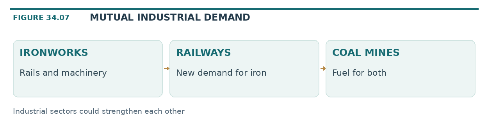

Индустриалните общества изискваха повече от нишка и власт. Имаха нужда от желязо за двигатели, инструменти, мостове, релси, кораби и сгради. Във Великобритания топенето на желязо с кокс, произведен от въглища, се развива много преди деветнадесети век, но подобренията в дизайна на пещта и използването на гориво постепенно увеличават производствения капацитет. Хенри Корт в края на осемнадесети век Пудлинг и ролка процеси бяха важни иновации сред няколко в ковано-желязо производство. По-късните технологии, включително процесът на Бесемер през 50-те години на миналия век, превръщат производството на стомана в основна характеристика на последваща фаза на индустриално развитие.

Производството на желязо беше верига от взаимно зависими дейности. Мините осигуряват руда и гориво; пещите се топят; леярни отливки; ковачи и валцуващи машини обработват метал; транспортни мрежи, свързани клиенти. Разширяващата се железопътна система генерира търсене на релси и локомотиви, а евтиното желязо подпомага по-нататъшното жп строителство. Подобни положителни отзиви свързани въглища минуване, парна енергия и машиностроене.

<figure class="figure" id="figure-34-7">

<figcaption>Фигура 34.7. Индустриалните сектори могат да се засилят взаимно. <a class="figure-anchor" href="#figure-34-7" aria-label="Link to this figure">#</a></figcaption>
</figure>

Новият промишлен пейзаж също имаше разходи. Мините излагаха работниците на срутвания, вода, прах и опасни газове. Огнеупорните райони генерираха топлина, отпадъци и замърсяване на въздуха. Инцидентите в промишлеността не бяха просто страничен продукт на индивидуална небрежност; те бяха оформени от технологии, работни часове, практики за безопасност, управленски стимули и силата на правната защита. Акаунт, който празнува инженерство също трябва да проучи кой носи риска от производство на неговите материали.
