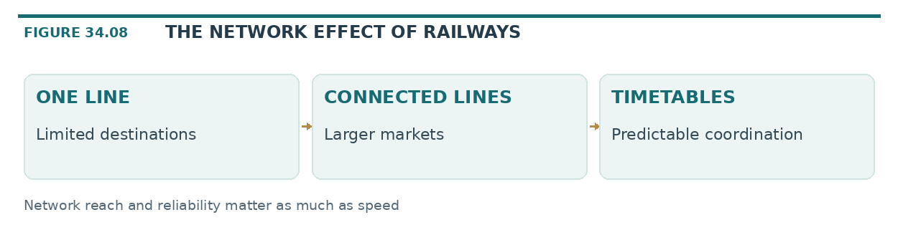

Стоктън и Дарлингтънската железница отварят през 1825 г. като забележителност при търговското използване на локомотиви и железопътен транспорт. Ливърпул и Манчестърската железница, открита през 1830 г., става влиятелен пример за линия, свързваща големите търговски центрове. Ранните железници смесват технологични експерименти с инвестиции, политически противоречия и обществено любопитство. Тяхното евентуално разширяване помогнало за по-бързо и по-предсказуемо движение, но следите били скъпи за полагане и изискване на мостове, тунели, станции, работилници, квалифицирани екипажи и надеждна поддръжка.

Железниците променят икономиката на времето. Производителите могат да планират доставки срещу публикувани графици; пресните храни достигат различни пазари; пътниците могат да живеят, работят и посещават на по-големи разстояния. Телеграфните системи по - късно подобрили координацията и железопътната операция допринесла за натиска към стандартизираното време. Въпреки това един нов маршрут би могъл да отклони търговията от по-старите пазарни градове, да намали приходите на някои превозвачи и да концентрира енергията в дружествата, които контролират критичната инфраструктура.

<figure class="figure" id="figure-34-8">

<figcaption>Фигура 34.8. Мрежата достига и надеждността е важна колкото скоростта. <a class="figure-anchor" href="#figure-34-8" aria-label="Link to this figure">#</a></figcaption>
</figure>

Железопътните линии са полезно проучване на мрежовите ефекти. Една изолирана линия може да предложи ограничена стойност; много свързани линии позволяват нови модели на пътуване и търговия. Обратно, железницата, построена без достатъчно товари, пътници или финансово планиране, може да се превърне в скъпо бреме. Индустриални промени съчетават грандиозно инженерство с обикновени проблеми на инвестициите, дълга, регулирането и монопола.
