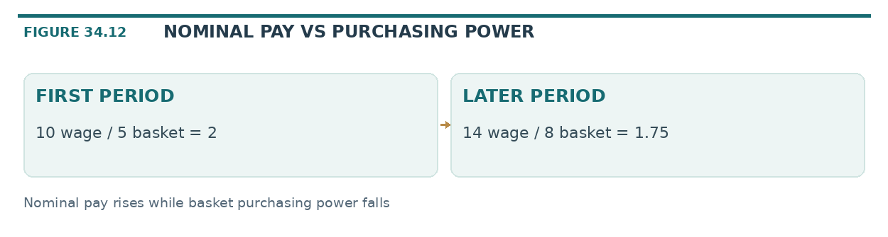

Да предположим, че хипотетичен работник спечели 10 единици седмично през 1800 и 14 единици през 1830. Бързото описание го нарича 40% увеличение на заплатата. Но ако една кошница с основни разходи 5 единици на първата дата и 8 на втората, работната заплата купува две кошници първоначално и само 1.75 кошници по-късно. Реалната покупателна способност падна въпреки по-високата номинална заплата. Това е илюстративно изчисление, а не реконструкция на историческа Великобритания.

Дори правилният индекс на реалната заплата оставя без отговор въпроси. Дали кошът отразява какво всъщност консумират бедните домакинства? Подобрени ли са стоките в качеството? Жените и децата печелят ли допълнителни доходи? Дали хората са се местили между градове или професии? Колко дни и часове са работили? Нарасна ли безработицата? Наемът, болестите, достъпът до чиста вода или пренаселването на града се промениха? Серия от заплати може да освети икономическата възможност, без да служи като пълна мярка за живото благополучие.

<figure class="figure" id="figure-34-12">

<figcaption>Фигура 34.12. Номиналната заплата се повишава, докато кошницата за закупуване на електроенергия пада. <a class="figure-anchor" href="#figure-34-12" aria-label="Link to this figure">#</a></figcaption>
</figure>

Историческите оценки често зависят от сметките на работодателите, градските институции, бюджетите на домакинствата, енорийските архиви и по-късните реконструкции. Оцеляването на информацията е неравномерно, особено за неофициална работа, приходите на жените и общностите извън големите търговски центрове. Отговорната история обяснява не само отчетения брой, но и групата, която описва, използвания индекс или допускания и как алтернативните мерки биха могли да променят тълкуването. Този метод ще се появи отново в по-късните ни глави относно икономиката и статистиката.
