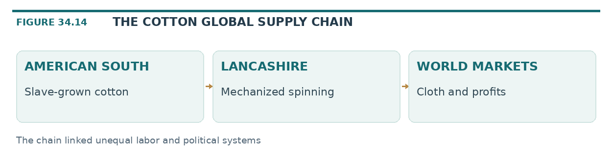

Индустриализирането на Европа беше част от световната икономика, оформена от завоевания, поробване, неравноправна търговия и политическа власт. Памуковите мелници в Ланкашир силно привличали суровия памук, отглеждан от поробения труд в американския Юг. Производителите продаваха продукти на пазарите в рамките и извън империите на Европа; търговците и финансовите институции свързваха индустриалните центрове с пристанищата и плантациите. Тези връзки правят невъзможно да се разбере фабриката само с поглед към вратите на фабриката.

Дебатите продължават с това колко печалби от робството и империята са допринесли за пълното финансиране на британската индустриализация. Заключението, че колониалната търговия е от значение не е същото като твърдението, че само печалбата от плантацията е причинила индустриалната революция. Учените разследват натрупването на капитал, суровините, държавните доставки, търсенето и промишлените технологии поотделно и заедно. По-ранните глави за атлантическо робство и разширяване на морската среда осигуряват необходимия контекст за тълкуване на тези аргументи.

<figure class="figure" id="figure-34-14">

<figcaption>Фигура 34.14. Веригата свързва неравнопоставени трудови и политически системи. <a class="figure-anchor" href="#figure-34-14" aria-label="Link to this figure">#</a></figcaption>
</figure>

Индустриализацията засегна и регионите, които вече имаха високоразвити занаятчийски икономики. Механизираният европейски текстил се конкурираше с индийските производители, докато колониалните тарифи, фискалните институции и достъпът до пазара промениха търговските условия. Времето и мащаба на индийската текстилна деиндустриализация се обсъждат, а износът на текстилни изделия не беше цялата производствена икономика на Индия. Основният въпрос е, че промяната на международните цени и неравните политически сили могат да прехвърлят възможности и разходи през континентите, дори когато изобретенията са произлезли далеч.
