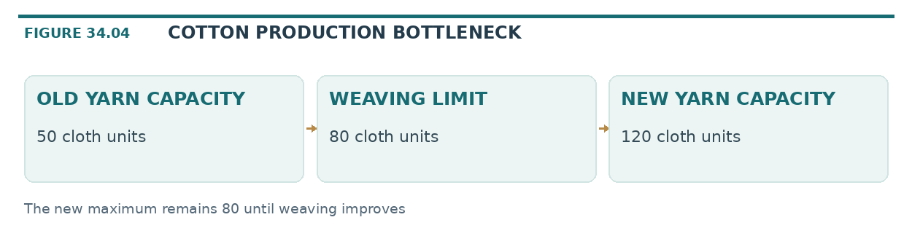

Въртящата се Джени, свързана с Джеймс Харгрийвс през 1760-те, позволи на един оператор да завърти няколко вретена. Водната рамка на Ричард Аркурайт използва захранвани ролки, за да рисува и усуква влакна, помагайки за създаването на по-силна прежда. Спининговото муле на Самуел Кромптън комбинира характеристиките на по-ранните системи и допринася за изтънченото и по-гъвкаво производство на прежди. Тези устройства са подобрени многократно от други механика и работници. Датите на изобретяването са етап от текущото развитие, а не момент, в който завършена технология незабавно завладява пазара.

Спининг машините промениха икономиката на текстилното производство. Домашен спинър, работещ с едно колело, се сблъскал с различни граници от мелница, която работи с много вретена с водна мощност. И все пак механизацията не просто премахва труда. Той промени задачите на работниците: грижа за машини, подготовка на материали, ремонтно оборудване и транспорт на продукти. Някои професии се свиха, възникнаха нови професии и разпределението на заплатите и силата на договарянето се измести.

<figure class="figure" id="figure-34-4">

<figcaption>Фигура 34.4. Новият максимум остава 80, докато тъкането се подобри. <a class="figure-anchor" href="#figure-34-4" aria-label="Link to this figure">#</a></figcaption>
</figure>

Помислете за хипотетичен текстилен процес, правещ прежда и тъкане на плат. Първоначално производството на прежда поддържа 50 броя плат на ден, докато ръчните платове могат да направят 80. По-бързите вретена увеличават капацитета на преждата до 120 единици, но максималната мощност на плата става 80, докато тъкането се подобри. Само спининговите инвестиции не могат да преодолеят новото шило. Този пример е измислен за преподаване; той показва защо историческите икономисти изучават свързани производствени системи, вместо да броят патентовани изобретения.
