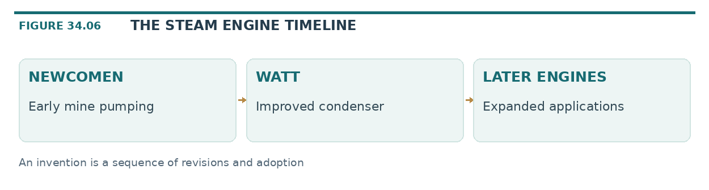

Първите атмосферни двигатели на Томас Нюкомен, разработени в началото на осемнадесети век, били особено полезни за изпомпване на вода от мините. Работата на Джеймс Уат върху отделен кондензатор, патентован през 1769 г., намали основен източник на пропиляна топлина и подобрена ефективност на двигателя. Търговското партньорство на Watt и Матю Болтън помогна за производството и внедряването на подобрени дизайни. Други инженери произвеждат свои собствени иновации, а двигателите с високо налягане впоследствие разширяват използването на парна енергия. Би било неточно да се каже, че Уат е изобретил първия парен двигател или че неговият модел веднага е сменил всички по-ранни системи.

Парните двигатели трябва да са изработени от точно оформени цилиндри, клапани и други компоненти. Това създаде търсенето на по-добри машини, металообработващи и инженерни стандарти. Захранването на парата също се нуждаеше от гориво, вода, квалифицирани оператори и редовен ремонт. По-широкото значение на едно изобретение се крие не само в неговия концептуален пробив, но и в това дали цели системи за производство и поддръжка могат да го подкрепят.

<figure class="figure" id="figure-34-6">

<figcaption>Фигура 34.6. Изобретението е поредица от ревизии и осиновяване. <a class="figure-anchor" href="#figure-34-6" aria-label="Link to this figure">#</a></figcaption>
</figure>

Да разгледаме две фабрики, които произвеждат подобни стоки. Единият седи до надеждна река, докато другият има лесен достъп до въглища и железопътни маршрути, но ненадежден воден поток. Парният двигател може да е икономичен на второто място преди първото. Така технологиите взаимодействат с географията, цените и съществуващите инвестиции. Историците изучават разпространението на техниката в различни места и кътчета, защото икономическите ефекти на една машина зависят от това колко широко, ефективно и надеждно се използва.
