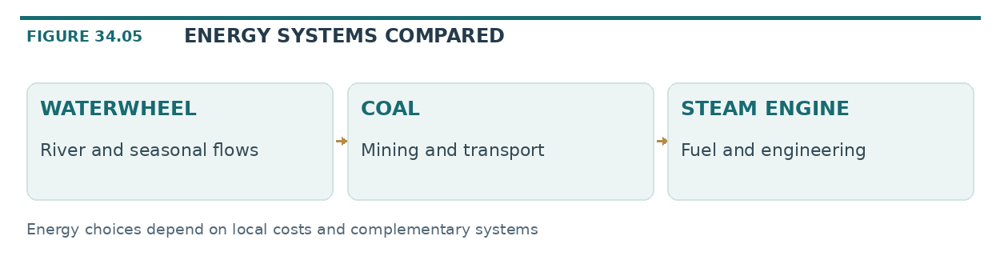

Ранните промишлени фабрики не зависели веднага от парата. Много мелници са построени близо до бързо течащи реки, защото водните колела осигуряват енергия. Местоположението им беше ограничено от сезонния поток, географията и собствеността върху водните права. Парните технологии постепенно разширяват обхвата на възможните индустриални локации, но осиновяването зависи от цените на горивата, ефективността и местните условия. Където въглищата били скъпи, водата можела да остане конкурентна за дълго време.

Въглищата вече са били изгорени за отопление и други цели преди индустриалната революция. Нарастващото му значение идва от взаимодействието с минните, металообработващите, парните двигатели и транспорта. Въглищните залежи обещаха концентрирана енергия; те също така изискваха миньори, капитал, дренаж и пътища или канали. Повече миньори могат да създадат търсене на помпи, което може да направи по-дълбоките мини възможни. Системата генерира собствени технологични възможности и опасности за безопасността.

<figure class="figure" id="figure-34-5">

<figcaption>Фигура 34.5. Енергийният избор зависи от местните разходи и допълващите системи. <a class="figure-anchor" href="#figure-34-5" aria-label="Link to this figure">#</a></figcaption>
</figure>

Фосиловите горива промениха дългосрочния енергиен таван. Общество, което разчита на дърво и животинска енергия, черпи енергия чрез земята, биомасата и ежедневните фуражи. Въглищата съхраняват енергия, натрупана през геоложкия период; изгарянето им позволява на едно място да използва енергия, която иначе би изисквала огромни площи от гори или пасища. Преходът не елиминира зависимостта от земята, културите или труда. Той даде възможност за нов и в крайна сметка много голям поток от енергия, докато въвежда дим, щети от мини и атмосферни въглеродни емисии, чиито последици се чувстват далеч отвъд първоначалните индустриални райони.
