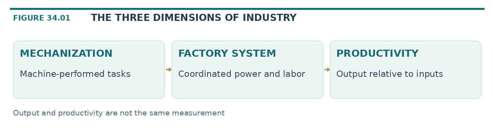

Индустриализацията е повече от появата на парен двигател или фабрика. Тя включва постоянно преминаване към производство и други дейности, които използват по-големи количества машини, специализиран труд, организирана енергия и капитал. Тя може да промени начина на производство на даден продукт, където живеят работниците му, как се финансира производството и как се разпределя продукцията. Една страна може да има голям промишлен сектор, без всяко домакинство да просперира; обратно, някои места могат да увеличат производителността чрез земеделие, услуги или дребномащабно производство, без незабавното възпроизвеждане на британския заводски модел.

Историците отличават механизацията, като използват машини за изпълнение на задачи, които преди това са извършвали хора или животни от организация фабрика, която концентрира хората и оборудването в рамките на координирано работно място. Те също така отделят промишленото производство от продуктивността. Ако работилницата прави двойно повече плат само защото наема два пъти повече работници за същите часове, производството се повишава, но продукцията на работник не може. Ако машините и по-добрата организация на двойното производство на плат със същите производствени суровини, производителността на труда се повишава. Един внимателен разказ също пита колко въглища, памук, вода, капитал и земя са били необходими, за да се осигури тази печалба.

<figure class="figure" id="figure-34-1">

<figcaption>Фигура 34.1. Изходът и производителността не са едно и също измерване. <a class="figure-anchor" href="#figure-34-1" aria-label="Link to this figure">#</a></figcaption>
</figure>

Най-ранните известни трансформации се случиха по-специално клонове на британски текстил, гладене и енергия. Останалата част от икономиката беше трансформирана с различни скорости. След 1850 г. индустриалните промени се ускориха в региони на континентална Европа и Северна Америка; по-късно индустриалците се възползваха от различни ресурси, трудови системи и държавни политики. Нямаше нито едно стълбище, на което всички общества стояха на друго стъпало.
