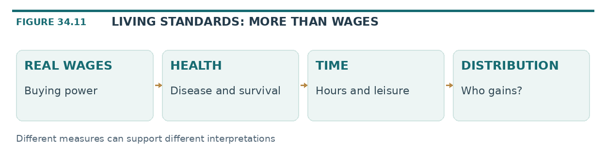

Историците са обсъждали този въпрос от поколения, защото различните измервания сочат в различни посоки. Индустриалната продукция и националните доходи се разшириха в дългосрочен план. И все пак реалните нещица, коригирани спрямо цените на стоките, не са непременно се повишили бързо за обикновените работници през първите десетилетия. Някои хора се възползвали от по - евтини произведени платове и нова заетост, докато страдали от по - дълги часове или по - лоши жилища. Други изпитват преки загуби, когато механизацията подкопава търговията им. Средният национален растеж и благосъстоянието на даден работник са различни твърдения.

Дебатът между "оптимистични" и "песимистки" интерпретации еволюира, тъй като изследователите сравняват заплатите, консумацията на храна, ръста, детската смъртност, работното време, неравенството, условията на живот и продължителността на живота. Тези мерки не могат да бъдат механично комбинирани без обсъждане на стойностите и качеството на данните. Човек, чиято заплата се увеличава, но работен ден расте по-дълго, може да има повече покупателна способност и по-малко свободно време. Един град, предлагащ много работни места, може да изложи децата на по - висока смъртност. Измерванията могат също така да отразяват различни подгрупи и региони, а не единен национален опит.

<figure class="figure" id="figure-34-11">

<figcaption>Фигура 34.11. Различните мерки могат да подкрепят различни тълкувания. <a class="figure-anchor" href="#figure-34-11" aria-label="Link to this figure">#</a></figcaption>
</figure>

Една важна интерпретация понякога се нарича Engels пауза: по време на период на нарастващ производствен капацитет, голяма част от печалбата първоначално натрупани към собствениците на капитали и други групи преди типичните заплати са нараснали значително. Това е хипотеза за разпределението и времето на печалба, а не твърдение, че всеки работник е по-беден. Дългосрочните подобрения в благосъстоянието и здравето, свързани с индустриалното развитие, са реални, но разпределението им зависи от институциите, общественото здраве, образованието, организацията на труда и последващите технологии.
