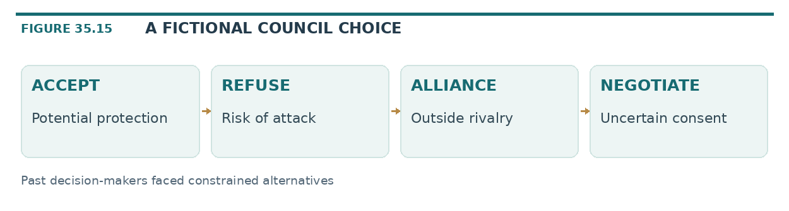

Един императорски агент иска договор, който обещава изключителни търговски права и "защита" от враговете. Агентът има малък въоръжен ескорт, но представлява власт с чуждестранни военни ресурси. Някои членове на съвета смятат, че споразумението може да осигури търговия и оръжия. Други се опасяват, че езикът ще даде възможност на чуждестранните служители да облагат с данъци общността и да заменят нейните институции. Съседското полство вече подписа договор и може да използва новия съюз срещу тази общност. Сценарият е измислен, за да осветява избора, а не да изобразява конкретен владетел.

Анализирайте четири възможности: приемете договора, откажете го, търсете конкурентен чуждестранен партньор или преговаряйте за ограничени търговски права без прехвърляне на суверенитет. Всеки има несигурни разходи. Отказът може да запази официалната независимост и все пак да предизвика атака; приемането може да намали непосредствена заплаха, но да засили бъдещото проникване; съпернически съюз може да се засили извън конкуренцията; ограничените условия могат да бъдат игнорирани или погрешно преведени. Никой не гарантира безопасност. Съветът също има вътрешни неравенства: търговците, фермерите, религиозните лидери и пасторалните общности могат да бъдат изправени пред различни последици.

<figure class="figure" id="figure-35-15">

<figcaption>Фигура 35.15. Предишните вземащи решения са били изправени пред ограничени алтернативи. <a class="figure-anchor" href="#figure-35-15" aria-label="Link to this figure">#</a></figcaption>
</figure>

Това обяснява защо ретроспективните морални решения не трябва да заменят историческия анализ. Можем ясно да осъдим завоеванието, докато признаваме, че хората под заплаха са изправени пред трудни решения с непълна информация. Задачата е да се реконструират техните алтернативи и институции, а не да си представим, че един очевиден избор би предотвратил всяко бедствие.
