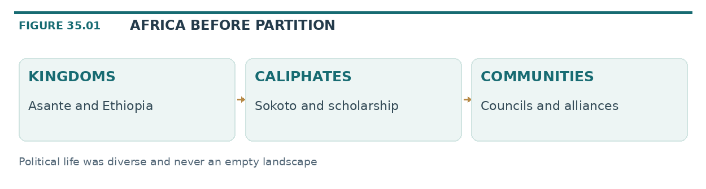

Около 1880 Африка съдържа поразително разнообразие от политически и социални договорености. В Западна Африка Асанте остава едно важно военно и търговско кралство - Сокото Калифат управлявал големи територии, а общностите покрай Нигер и крайбрежието се ориентирали към стари търговски и религиозни мрежи. В интериора традициите на Луба и Лунда, царството Йейк и много други поляци оформят централната африканска политика. По протежение на източното крайбрежие търговците и религиозните лидери свързаха африканските общности с икономиките в Индийския океан. На юг, Нгуни-говорящи кралства, заселници държави, африкански вождове и търговски общности взаимодействат чрез война и дипломация.

Политическата власт не беше навсякъде подредени като териториално ограничена централизирана държава. Някои общности се управляват чрез съвети, възрастови степени, групи за спускане, градове или гъвкави съюзи. Други имали сложни бюрократи и армии. Липсата на европейски капитал или фиксирана обследвана граница не означава липса на закон или суверенитет. Земята може да бъде култивирана индивидуално, но контролирана чрез колективни искове; правата на паша могат да зависят от сезонни споразумения; членството в политическа общност може да зависи повече от лична вярност, отколкото точна линия на карта.

<figure class="figure" id="figure-35-1">

<figcaption>Фигура 35.1. Политическият живот е разнообразен и никога не е бил празен пейзаж. <a class="figure-anchor" href="#figure-35-1" aria-label="Link to this figure">#</a></figcaption>
</figure>

Европейските разкази понякога описват територията като празна, политически неорганизирана или чакаща да бъде развита. Този език може да превърне непознати институции в предполагаемо оправдание за завоевание. Следователно първата методическа задача е да се възстановят африканските общества от африканската устна история, археологията, материалната култура, местните документи, ислямската стипендия и критичното четене на европейските сметки. По - късно колониалните архиви може да са богати на информация, като същевременно отразяват приоритетите на длъжностните лица, които ги произвеждат. \[<a href="/035-imperialism-and-african-partition/sources/#source-1" class="cite">1</a>\]\[<a href="/035-imperialism-and-african-partition/sources/#source-2" class="cite">2</a>\]
