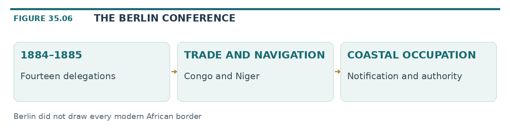

В Берлин канцлерът Ото фон Бисмарк е домакин на дипломати от четиринадесет държави между 1884 и 1885 година. Нито един африкански владетел не бил представляван. Общият закон обсъжда свободата на търговия в части от Централна Африка, навигацията върху Конго и Нигер, потискането на търговията с роби и условията, при които новата окупация на африканските брегове ще бъде призната от други сили. Членове 34 и 35 са особено свързани с уведомяване и ефективна окупация за някои нови крайбрежни искове. \[<a href="/035-imperialism-and-african-partition/sources/#source-7" class="cite">7</a>\]

Конференцията не събра пълен атлас и възложи всеки регион на Африка на колониален собственик. След това много граници били договорени чрез отделни договори, проведени на етапи или наложени чрез война. Някои имали истории, които предшествали 1884 г.; други не били финализирани десетилетия наред. Дипломатическите декларации често надвишават административните възможности на място. Да се каже, че конференцията помогна за организирането на европейското разделение е правилна; да се каже, че тя привлече всяка модерна африканска граница на едно заседание е неточна.

<figure class="figure" id="figure-35-6">

<figcaption>Фигура 35.6. Берлин не е изтеглил всяка модерна африканска граница. <a class="figure-anchor" href="#figure-35-6" aria-label="Link to this figure">#</a></figcaption>
</figure>

Нейната по-дълбока важност е отчасти в това, което липсваше: Африканско съгласие и политическо равенство. Европейските сили разискваха кои от тях биха могли да претендират за власт, а не дали независими общности искат да я предадат. Клаузите, призоваващи към благополучие или към прекратяване на робството, не премахнаха фундаментално принудителния характер на диспоненцията. Конференцията осигури правила за императорската конкуренция при нормализиране на предпоставката, че чужденците могат да преговарят за африкански суверенитет помежду си. \[<a href="/035-imperialism-and-african-partition/sources/#source-7" class="cite">7</a>\]\[<a href="/035-imperialism-and-african-partition/sources/#source-8" class="cite">8</a>\]
