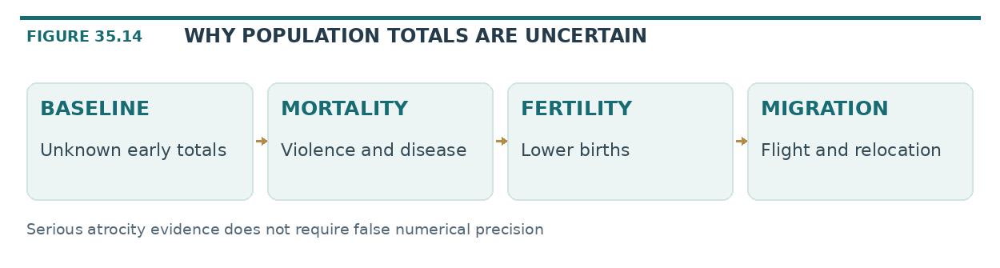

Публични описания на Леополд II Конго често повтарят много големи смъртни случаи, понякога използвайки кръгло число, без да показват метода зад него. Мащабът на насилието не е сериозно съмнение; кланета, вземане на заложници, принудителен труд, полет, глад, нарушен плодородие и болести са подкрепени с множество видове доказателства. Но възстановяването на общата демографска загуба изисква оценка на предконкуренцията и по-късните нива на населението в широк регион, където липсват пълни преброявания. Различните базови допускания могат да доведат до рязко различни резултати.

Отговорната историческа оценка отличава смъртните случаи, причинени пряко от насилието, от по-широк демографски спад, като същевременно признава, че те са свързани. Населението може да падне, защото смъртността нараства, раждаемостта намалява и хората мигрират. Доклад за по-малко жители в една област може да отразява изместването, както и смъртта. Третирането на всички тези механизми като взаимозаменяеми не е внимателна аритметика. От друга страна, посочването на несигурност не е защита на режима. Не ни трябва точно число, за да разпознаем система от тежки злоупотреби.

<figure class="figure" id="figure-35-14">

<figcaption>Фигура 35.14. Сериозните улики за зверство не изискват фалшива числова точност. <a class="figure-anchor" href="#figure-35-14" aria-label="Link to this figure">#</a></figcaption>
</figure>

Случаят прави един общ урок конкретен: когато се установи историческо престъпление, дебатът върху неговата числена скала трябва да усъвършенства нашето разбиране, вместо да се превърне в извинение да го отречем. Историците трябва да обяснят какво има значение за всяка оценка, какви доказателства го подкрепят и какво остава неизвестно. Източници като докладите за реформите в Конго се нуждаят от контрол, но също така се извиняват на колониалните власти. \[<a href="/035-imperialism-and-african-partition/sources/#source-5" class="cite">5</a>\]\[<a href="/035-imperialism-and-african-partition/sources/#source-16" class="cite">16</a>\]
