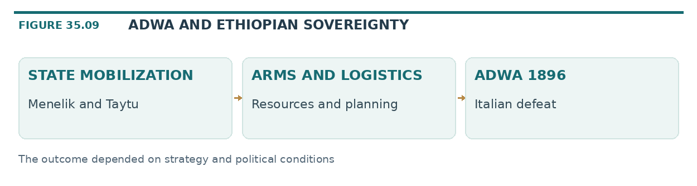

Етиопската империя била едно от най-значимите изключения от европейското завоевание по време на бъркотията. Император Менелик II използва дипломация, разширяване в региона, военна модернизация и покупки на оръжие, за да укрепи състоянието си. Вътрешното разнообразие на Етиопия и нейните собствени имперски завоевания трябва да бъдат признати заедно с успешната й защита срещу европейския империализъм. През 1889 г. Договорът от Wuchale (Ucciali) става обект на различни италиански и етиопски интерпретации относно това дали Етиопия е приела италиански контрол върху външните отношения.

Когато Италия се опитала да наложи иска си, Менелик мобилизирал голяма сила, подкрепяна от военни лидери и общности в цялата му империя, включително Императрица Тайту Бетул. Етиопската победа в Адва на 1 март 1896 г. унищожила непосредствения италиански проект за завоевание и осигурила международно признаване на етиопската независимост. Това беше победа на организираното снабдяване, лидерство, ефективно въоръжение, политическа мобилизация и стратегия, а не доказателство, че една армия притежава магически имунитет към европейските военни технологии. \[<a href="/035-imperialism-and-african-partition/sources/#source-11" class="cite">11</a>\]

<figure class="figure" id="figure-35-9">

<figcaption>Фигура 35.9. Резултатът зависи от стратегията и политическите условия. <a class="figure-anchor" href="#figure-35-9" aria-label="Link to this figure">#</a></figcaption>
</figure>

Битката се превърна в мощен символ за по-късно африкански и диаспорични политически движения. Той също така предлага сравнителен въпрос: защо Етиопия може да устои на това къде други държави са загубили суверенитет? Факторите включваха география, централизирана мобилизация, дипломатически възможности, налични оръжия, лидерство и границите на италианското планиране. Няма просто класиране на културни заслуги или смелост обяснява разликата. Победата на Етиопия разкрива, че резултатите зависят от конкретни политически и материални обстоятелства.
