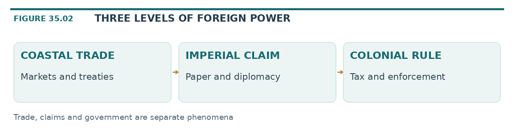

Европейците са търгували по африканските брегове векове наред без рутинно да командват огромни континентални територии. Португалските и други търговци купуват злато, слонова кост и пленници; търговската дейност често зависи от африканските власти, които контролират маршрутите, данъците, дипломацията и достъпа до вътрешния пазар. През деветнадесети век подтискането на трансатлантическата търговия с роби става неравномерно, а търговията с палмово масло, фъстъци, карамфили, дървен материал и други продукти се разширява. Тези промени не са създали автоматично европейските правителства над африканското население.

Териториалната империя включвала нови изисквания: замяна или подчиняване на владетели, администриране на данъци, установяване на съдилища, защита на концесии, наемане или завладяващ труд и предявяване на изключителна юрисдикция. Търговците можеха да подкрепят процеса, когато искаха предсказуеми тарифи или сигурни договори, но мнозина не се нуждаеха от приложение, за да печелят печалби. Мисионерите може да критикуват злоупотребите и да предоставят образование, като същевременно подкрепят твърденията за европейско морално превъзходство. Изследователи, инспектори и чартърни компании помогнаха за създаването на географско разузнаване; някои станаха политически лобисти за завладяване.

<figure class="figure" id="figure-35-2">

<figcaption>Фигура 35.2. Търговията, исковете и правителството са отделни явления. <a class="figure-anchor" href="#figure-35-2" aria-label="Link to this figure">#</a></figcaption>
</figure>

Бреговото знаме, подписаният търговски договор и ефективното управление бяха различни неща. Някои императорски правителства направиха амбициозни искания за карта с малко служители във вътрешността. На друго място, особено заселническите райони и стратегическите пристанища, политическият контрол беше много по-натрапчив. Хронологията на империализма няма никакъв смисъл, освен ако не разделим икономическото влияние, дипломатически претенции, принудителна окупация и рутинна администрация.
