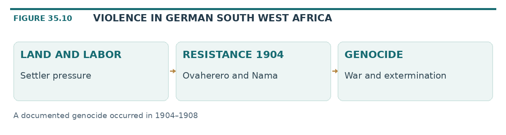

В Германия, Южна Западна Африка, настоящите изисквания за земята на Намибия, загубите на добитъка, дълга, расовата дискриминация и принудителните трудови политики предизвикаха силен натиск. През 1904 г. хората от Овахереро се надигнали срещу колониалното управление. Германското военно отмъщение ескалира в кампания на изтребление, включително нападения срещу цивилни лица, шофирането на хора в безводни региони, задържане и принудителен труд. Нама общностите също се съпротивляваха, а немските репресии продължиха през 1908 г. Събитията са широко признати от историците като геноцид. Германия публично призна своята историческа и морална отговорност, въпреки че политическите и правни въпроси около реституцията остават спорни. \[<a href="/035-imperialism-and-african-partition/sources/#source-12" class="cite">12</a>\]

Геноцидът не е злощастен страничен ефект на обикновената администрация. Това беше целенасочена програма за унищожение, свързана с колониална власт, расизъм, военни решения и отнемане. Данните за смъртните случаи се различават по източник и метод; липсата на един неоспорим брой не трябва да се използва, за да се прикрие огромната загуба на живот. Показания на жертви, военни заповеди, памет на оцелелите, записи от мисии и по-късни разследвания разкриват как държавното насилие и унищожаването на поминъка взаимно се укрепват.

<figure class="figure" id="figure-35-10">

<figcaption>Фигура 35.10. Документиран геноцид е възникнал през 1904-1908 г. <a class="figure-anchor" href="#figure-35-10" aria-label="Link to this figure">#</a></figcaption>
</figure>

Случаят също така води до трудно сравнение. Заселническите колонии биха могли да направят земя и труд централни политически цели, създавайки специфични стимули за преместване. Но насилственото принуда не се ограничаваше само до режимите на заселниците; плантационните и концесионните системи другаде предизвикваха екстремни злоупотреби без големи европейски популации от заселници. Сравняването на колониалните форми помага да се идентифицират механизмите, вместо да се третира всяка империя като идентична институция.
