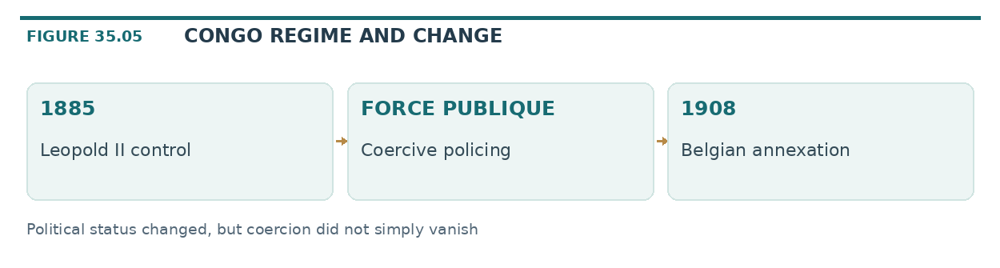

Речният басейн на Конго се превърна в място за един от най-скандалните колониални режими. Белгийският крал Леополд II подкрепи проучването и създадените организации, представени публично като научни или хуманитарни предприятия, докато се стреми към териториален контрол. Неговите агенти потърсиха споразумения, а европейските дипломати договориха търговския и политически статут на региона. До 1885 г. свободна държава Конго се появява като отделна държава под личния суверенитет на Леополд, а не просто като обикновена белгийска колония. Официалното белгийско приложение е дошло едва през 1908 г.

Завоеванието и администрацията са неравни. Силата Публик, създадена през 1885 г., е въоръжена сила с африкански войници под европейско командване. Частни концесионни дружества и държавни служители извлякоха труд и ресурси, особено слонова кост и по-късно див каучук. Общностите бяха подложени на квоти, вземане на заложници, насилие, принудително прехвърляне и тежко наказание. Огромните страдания и демографските катаклизми са силно документирани; опитите да се посочи една точна обща смъртност от колониални зверства, болести, глад и намаляващи раждания включват голяма несигурност.

<figure class="figure" id="figure-35-5">

<figcaption>Фигура 35.5. Политическият статут се промени, но принуда не просто изчезна. <a class="figure-anchor" href="#figure-35-5" aria-label="Link to this figure">#</a></figcaption>
</figure>

Случаят Конго показва как риториката на свободната търговия и потискането на робството биха могли да съществуват заедно с принудителни трудови системи. Той също така показва, че дори Берлинската конференция не трябва да бъде изобразявана като събитие, в което делегатите просто са дали на Леополд напълно картографирана страна. Признаване, претенции за суверенитет, договори и действително принудителна окупация, разработени чрез припокриване на дипломатическите процеси. Доклади на африкански свидетели, мисионери, длъжностни лица, следователи и реформатори в крайна сметка изобличиха режима, но само международната критика не прекрати незабавно експлоатацията. \[<a href="/035-imperialism-and-african-partition/sources/#source-5" class="cite">5</a>\]\[<a href="/035-imperialism-and-african-partition/sources/#source-6" class="cite">6</a>\]
