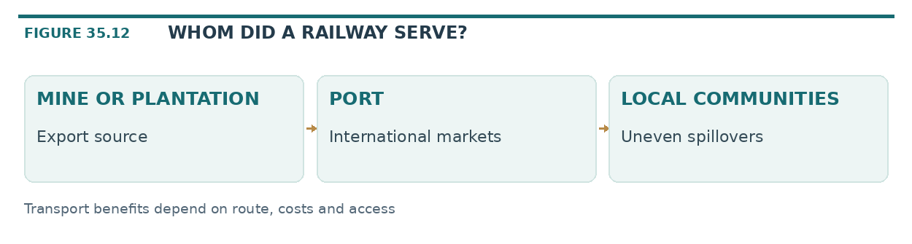

Колониалната инфраструктура понякога се обсъжда по отношение на заблуждаващ избор: или железниците са били дарове за модернизация, или са били просто безполезни инструменти за извличане. И двете описания изравняват различни истории. ЖП линиите свързват пристанищата с минните райони, зоните за касови операции и административните центрове. Те биха могли да намалят транспортните разходи, да подкрепят миграцията и да улеснят новите пазари. Но изборът на маршрути често обслужваше търговски отстъпки и военна стратегия, а не балансираните потребности от мобилност на всички общности.

Представете си хипотетична колония с два възможни маршрута. Линията от меден район до крайбрежно пристанище обещава големи приходи от износ; втора линия, свързваща няколко гъсто населени фермерски града, може да подобри местните хранителни пазари, но генерира по-малки незабавни приходи към колониалната хазна. Администрацията, която приоритизира приходите от данъци и износ, може да избере първата линия, дори ако втората има по-широки ползи за развитието. Примерът е измислен, но аналитичното разграничение е реално: инфраструктурата може да има продуктивен ефект, докато се планира при неравни политически приоритети.

<figure class="figure" id="figure-35-12">

<figcaption>Фигура 35.12. Ползите от транспорта зависят от маршрута, разходите и достъпа. <a class="figure-anchor" href="#figure-35-12" aria-label="Link to this figure">#</a></figcaption>
</figure>

ЖП линиите изискваха и придобиване на земя, труд, полиция и финансиране. Разходите за строителство могат да се поемат чрез публичен дълг, митнически приходи или принудителна работа; последващите печалби биха могли да бъдат разпределени между европейските акционери, колониалните длъжностни лица и африканските земеделски стопани или търговци в много различни пропорции. За да оцените дадена железопътна линия, попитайте кой е платил, кой е бил изселен, кой е можел да пътува, какво е свързвал и какви алтернативни инвестиции са били изключени. Само един оцелял мост не може да отговори на тези въпроси.
