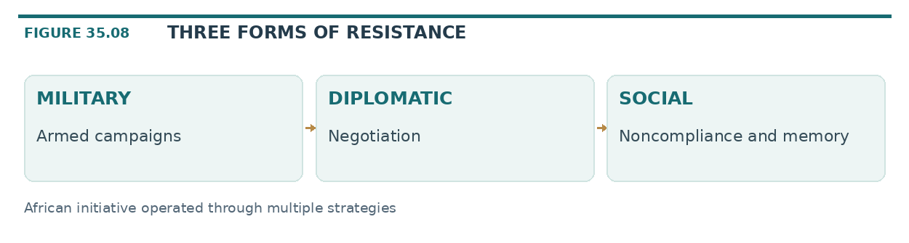

Samori Touré построен мощен щат в Западна Африка през края на деветнадесети век, мобилизира армии, придобиване на огнестрелни оръжия, реорганизиране на доставките и преместване на неговия политически център в отговор на френски напредък. Кампаниите му срещу разширяването на френското управление продължили години преди залавянето му през 1898. Той също така завладява и принуждава други африкански общности; признавайки съпротивата си към Франция не изисква да си представя, че собствената му държава е свободна от разширяване или насилие. Историите на съпротивата стават по-силни, когато африканските лидери се третират като истински стратези, а не като безупречни символи.

Асанте, съсредоточена в това, което сега е Гана, се сблъска с дълга поредица от конфликти с британците. Политическите спорове, търговските съперничества и войните предшестваха късния период на разбъркване. През 1900 г. Яа Асантеваа помага за воденето на въоръжената съпротива след британско искане относно Златния Стоул, централен символ на авторитета на Асанте. Войната завърши с британската победа, а Ашанти беше приложен през 1901 г., но неговият политически и културен живот не бе погасен. Националният музей на африканските изкуства в Смитсониан подчертава Яа Асантеваа като основна фигура на съпротивата. \[<a href="/035-imperialism-and-african-partition/sources/#source-10" class="cite">10</a>\]

<figure class="figure" id="figure-35-8">

<figcaption>Фигура 35.8. Африканската инициатива се осъществява чрез множество стратегии. <a class="figure-anchor" href="#figure-35-8" aria-label="Link to this figure">#</a></figcaption>
</figure>

Сравняването на Самори и Асанте разкрива различни възможности. Един владетел може да централизира военната власт или да търси съюзи, да смени територията си или да се бори за запазване на свещената и конституционна власт. Нито една от тези стратегии не гарантира победа срещу разширяване на армии, подкрепени с по-широки имперски ресурси. Но никой не може да бъде намален до неизбежно поражение. Съпротивата промени разходите, времето, политическите селища и спомените за легитимното управление.
