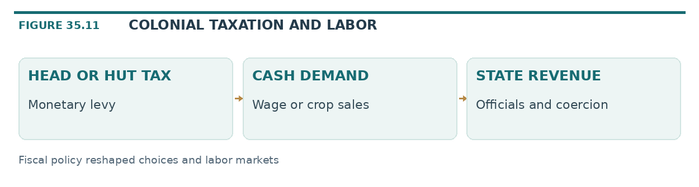

Колониалните администрации се нуждаеха от ресурси, за да плащат на войници, длъжностни лица, комуникационни системи и инфраструктура. Те често разчитаха на мита, данъци върху колибите или главите и други налози. Данъчните задължения могат да подтикнат хората към работна заплата или да предлагат на пазара култури, когато плащането трябва да се извършва в пари. Въпреки това последиците зависели от достъпа до пазарите, местните земеделски модели и способността за договаряне или избягване на искания. Данъчното облагане е едновременно източник на приходи, средство за политически контрол и инструмент за реорганизиране на труда.

В някои колонии принудителният труд принуждаваше хората да строят пътища, да носят товари, да култивират конкретни култури или да изпълняват държавни задължения без действително безплатно съгласие. Концесионните дружества и местните администратори налагат особено тежки тежести в някои области. На други места африканските дребни стопани са приемали доброволно или отчасти търговски култури под натиск, като понякога са печелили доходи и са организирали силни производствени мрежи. От съществено значение е да се открои търговската възможност от принуда; и двете могат да присъстват в една и съща местна икономика.

<figure class="figure" id="figure-35-11">

<figcaption>Фигура 35.11. Фискалната политика промени изборите и пазарите на труда. <a class="figure-anchor" href="#figure-35-11" aria-label="Link to this figure">#</a></figcaption>
</figure>

Неотдавнашните изследвания за възстановяване на колониалното данъчно облагане показват, че ранните администрации са имали ограничен данъчен капацитет и зависят от търговските данъци и трудовите задължения. Това помага да се обясни защо една огромна императорска карта може да скрие много плитко бюрократично състояние. Един владетел, който може да обяви нов данък, не винаги би могъл да го събере; длъжностни лица преговаряха чрез брокери и понякога разчитаха на наказание, когато спазването му се провали. \[<a href="/035-imperialism-and-african-partition/sources/#source-13" class="cite">13</a>\]
