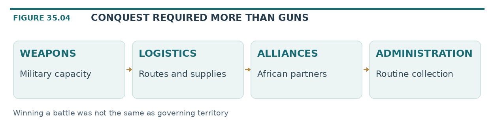

Понякога европейското завоевание е обобщавано като състезание между картечници и копия. Това е подвеждащо. Африканските сили притежавали или придобили огнестрелни оръжия от различни видове, модифицирали тактиката си, изграждали защити, организирали кавалерия и умело използвали терен. В същото време европейските сили все повече се възползват от пушките, артилерията, по-късните картечници, парния транспорт и мрежите за получаване на боеприпаси и резервни доставки. Военният баланс варира значително по десетилетие, терен, местни съюзи и ресурсите на бойните партии.

Болестите в миналото ограничавали много европейци да се движат в тропически райони. Хининът, използван срещу маларията, направи някои пътувания и гарнизони по-устойчиви, но неговите защитни ползи зависеха от правилното използване и знания; епидемиите, включително маларията и жълтата треска, останаха сериозни проблеми. ЖП линиите можеха да подкрепят доставките и разполагането на войски, но изграждането им изискваше скъпи проучвания, земя и труд. Реките предлагали маршрути, но също и бързини, водопади и сезонни препятствия. Транспортът през пустини, планини и горски зони все още може да бъде бавен и опасен.

<figure class="figure" id="figure-35-4">

<figcaption>Фигура 35.4. Спечелването на битка не било същото като управлението на територията. <a class="figure-anchor" href="#figure-35-4" aria-label="Link to this figure">#</a></figcaption>
</figure>

Никоя технология не прави завоеванията автоматични. Армия, която може да победи противник в открита битка, може да не е в състояние да контролира всяко село или да принуди надеждно плащане на данъци. Много имперски победи зависели от африкански войници, носачи, водачи, доставчици, преводачи и съюзнически политически лидери, чиито мотиви варирали. Такава зависимост усложнява всяка проста картина на малка европейска армия, която завладява континента само чрез по-висши оръжия. Военната власт направи някои професии възможни; тя не ги обясни без политика и местни истории.
