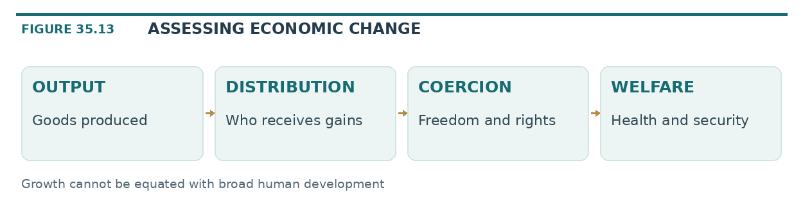

Дебатът за колониалните икономически наследства често представя противоположни изображения: едната страна сочи към пътища, железопътни линии, пристанища и нови култури; друга сочи към обезвладяване, принудителен труд и неравноправна търговия. Първият образ може да пропусне кой контролира инвестициите и чийто труд е платен за тях. Вторият може да пропусне икономическата инициатива на африканските работници и земеделски стопани, някои от които се възползваха от нови или разширени пазари при изключително неравностойни условия. И двата вида наблюдения могат да бъдат верни, а нито един от тях не взема мерки за общото благосъстояние.

Помисли за конкретен регион с пари в брой. Земеделското домакинство може да спечели повече от какаото, отколкото от предишната комбинация от дейности, но също така може да се сблъска с данъци, нестабилност на цените и задължения, които намаляват свободата на избор. В близкия район може да се загуби достъп до концесии, без да се получават сравними ползи. Пристанищен град може да расте, докато селските общности губят услуги. Следователно приходите от свръхпроизводство не могат да понесат подобрения в областта на здравеопазването, храненето, политическите права или разпределението на доходите. Когато има данни за колониалния БВП, те изискват внимание към непълните записи и определения.

<figure class="figure" id="figure-35-13">

<figcaption>Фигура 35.13. Растежът не може да се приравни с широкото човешко развитие. <a class="figure-anchor" href="#figure-35-13" aria-label="Link to this figure">#</a></figcaption>
</figure>

Икономическите историци сравняват институциите, даренията и различните колониални траектории. Те питат дали добивът е обезкуражил инвестициите в местното производство, дали политическите бариери са ограничили африканските предприятия и как колониалните държави разпространяват образованието, здравеопазването и транспорта. Няма надеждна универсална присъда, че всяка предколониална икономика е просперираща или че всяка колониална икономическа промяна е еднакво вредна по същия начин. Съществуват обаче неоспорими доказателства, че колониалният суверенитет е неравнопоставен и често налага огромни неволеви разходи на африканското население. \[<a href="/035-imperialism-and-african-partition/sources/#source-14" class="cite">14</a>\]\[<a href="/035-imperialism-and-african-partition/sources/#source-15" class="cite">15</a>\]
