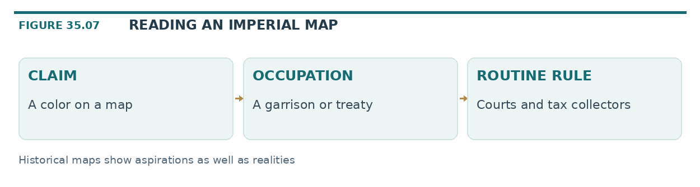

Исторически карти са необходими, но те канят опасен пряк път. Една карта цветове Африка според европейските претенции през 1880 г.; друга показва формални имперски граници около 1914 година. Техният остър контраст улавя скоростта на разделяне. Но цветните петна могат да се подведат, ако зрителят предположи, че всеки квадратен километър е ефективно управляван от датата, отпечатана над картата. Гранична област с един патрул и подписан договор се различавала от установения колониален капитал, свързан с железниците и плантациите и полицейските постове.

Картите също така изкривяват африканските истории, като предопределят европейските гранични органи и скриват по-старите припокриващи се органи. Пасторска общност може да използва земя от двете страни на новата граница. Царството може да претендира за почит от разпръснати селища, вместо да управлява компактен блок територия. Граничните комисии понякога следвали реки, линии на ширината или маршрутите за транспорт, а в други случаи се опирали на познаването на по-ранните африкански граници. Неотдавнашната стипендия показва, че някои граници са били по-небрежно проектирани и някъде по-отзивчиви към съществуващите политически пейзажи, отколкото популярното твърдение, че те са напълно случайни предполага. \[<a href="/035-imperialism-and-african-partition/sources/#source-9" class="cite">9</a>\]

<figure class="figure" id="figure-35-7">

<figcaption>Фигура 35.7. Историческите карти показват стремежи, както и реалност. <a class="figure-anchor" href="#figure-35-7" aria-label="Link to this figure">#</a></figcaption>
</figure>

Правилният въпрос не е само дали редовете са били "арбитър." Попитайте произволно по отношение на чии претенции и цели? Границата може да бъде рационална за европейските преговарящи, търсещи железопътна линия, но разрушителна за земеделските стопани. Тя може да използва реката като очевиден картографски разделител, докато разделя пазарна мрежа, която винаги е преминавала през нея. Трябва да разграничим произхода на границите от по-късните избори на независимите африкански правителства, които като цяло наследиха колониални граници поради причини, свързани със сигурността и междудържавната стабилност.
